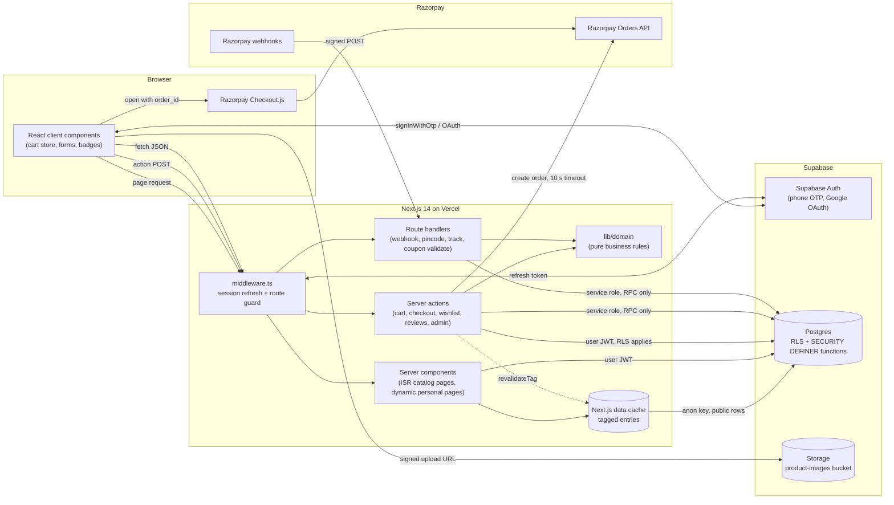
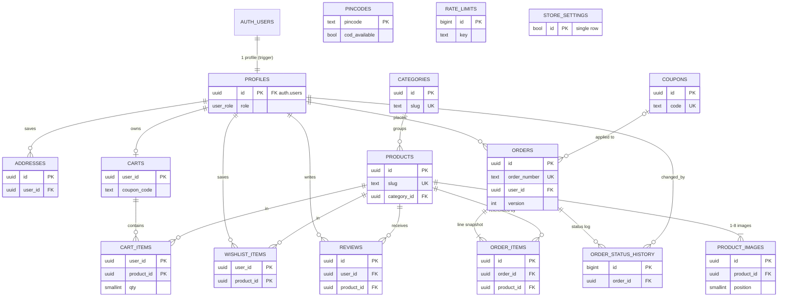
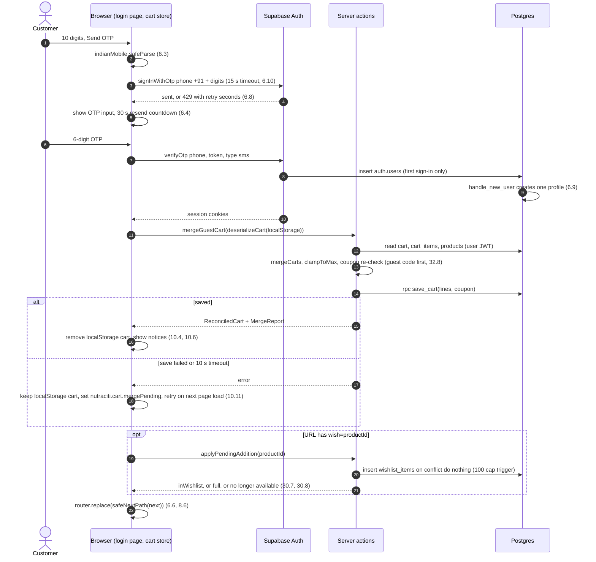
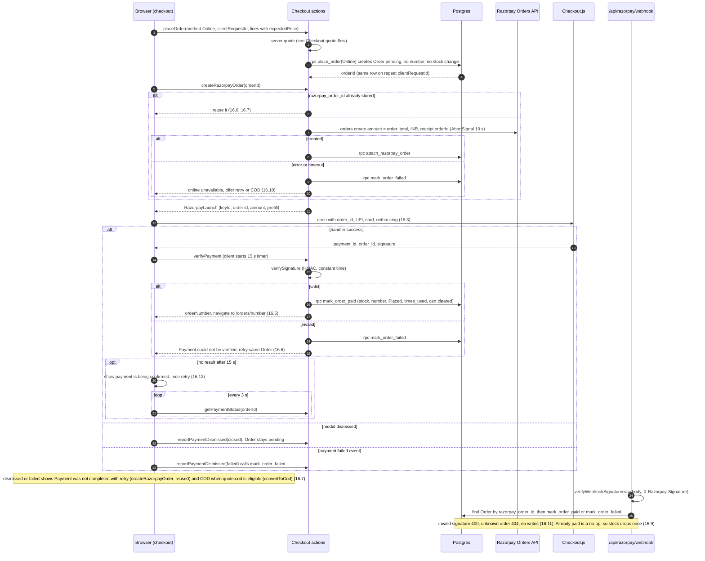
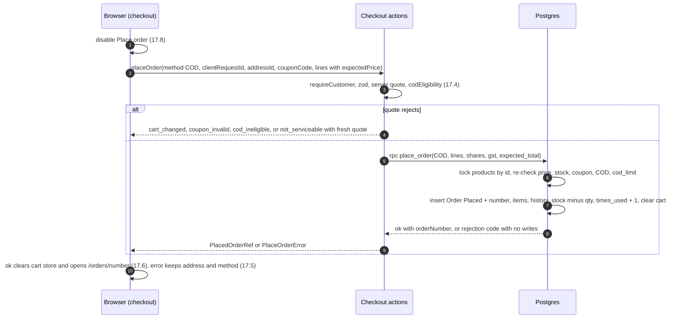
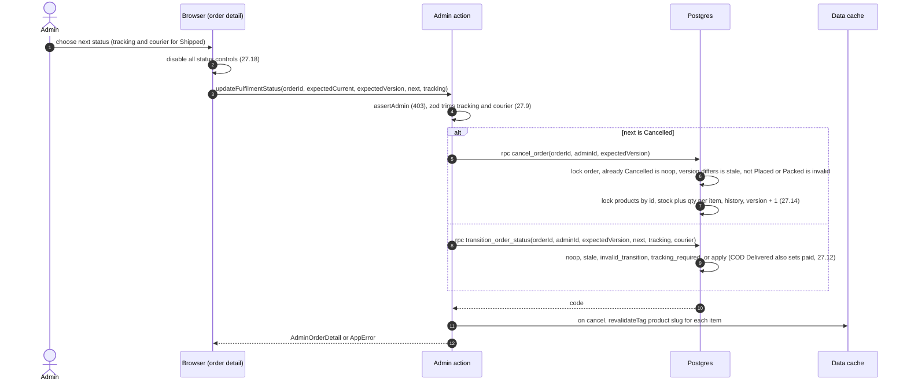

# Design Document

## Overview

The Nutraciti storefront is one Next.js 14 App Router application in TypeScript, deployed on Vercel. Supabase provides authentication (phone OTP and Google), Postgres, and Storage for product images. Razorpay handles online payments. Public catalog pages (Homepage, Shop, Product Detail, About Us) are rendered on the server and cached, so search engines and first-time visitors get complete HTML (Requirement 21). Personal pages (Cart, Checkout, Account, Wishlist, order confirmation, Admin_Dashboard) are rendered per request against the signed-in user's session.

Business rules that must be exact, such as money formatting, cart arithmetic, coupon discounts, GST allocation, slugs, order status transitions, and tracking matches, are written as pure TypeScript functions in `src/lib/domain`. The browser and the server use the same functions, so the totals a Customer sees equal the totals the server stores (Requirements 15.6, 34.10). Operations that change several rows at once (placing an order, marking it paid, cancelling it, adjusting stock) run inside Postgres functions, so each one either completes fully or leaves no change.

### Key design decisions

- **Next.js 14 App Router with TypeScript.** This is the stack named in the requirements. Server components and the data cache cover the SEO and LCP targets in Requirement 21 without a separate API tier.
- **Server components for SEO pages.** `/`, `/shop`, `/products/[slug]` and `/about` render on the server with their headings, prices and image references in the initial HTML (21.1). Parts that depend on the session, such as the header account slot, badges, wishlist hearts and the review form, are small client components. The cached HTML is the same for every visitor, so these pages can still use ISR.
- **Server actions for form mutations, route handlers for JSON and webhooks.** Cart sync, checkout, wishlist, reviews and every admin form use server actions, which come with built-in CSRF protection. Route handlers serve the Razorpay webhook, which needs the raw request body for signature checks, and the public JSON endpoints whose HTTP status codes the requirements specify: `/api/track` (28.10), `/api/coupons/validate` (32.12) and `/api/pincode/[pincode]`. Server actions cannot set an HTTP status, so every action returns a `Result` whose error carries a `status` field (400/403/404/409/429). The 400 (22.7), 403 (24.5, 29.13) and 409 (27.8) outcomes for admin and review mutations are checked against this field. **Flag for review:** if a literal HTTP status code is required for these mutations, the same service functions can be exposed under `/api/admin/*` route handlers without changing the domain code.
- **All money as integer paise.** The database uses `bigint` columns and TypeScript uses `number`; every paise amount the requirements allow is below 2^53, so `number` holds it exactly. Rupee input is converted once at the form boundary (25.11, 25.25, 31.9). No floating-point rupee values are stored or summed, which keeps the identities in 15.6, 33.12 and 34.12 exact.
- **Pure domain logic in `src/lib/domain`.** These modules have no I/O and no `Date.now()` calls; the clock and IST date are passed in as arguments. This makes them suitable for property-based tests with fast-check.
- **Postgres functions for atomic order and stock operations.** `place_order`, `mark_order_paid`, `mark_order_failed`, `transition_order_status`, `cancel_order` and `convert_order_to_cod` are `SECURITY DEFINER` functions. `EXECUTE` on them is revoked from `anon` and `authenticated` and granted only to `service_role`. Server code calls them through a service-role client after it has authenticated the caller, and passes the verified user ID as a parameter. Stock is decremented with `UPDATE ... SET stock = stock - q WHERE stock >= q`, with rows locked in product-ID order to avoid deadlocks. This gives correct concurrent placement and never lets stock go below zero (18.4). Payment status is checked before any change, so stock is reduced exactly once per Order (16.9, 27.20, 27.21).
- **Supabase RLS as the second layer.** Every table has RLS enabled, with owner-only policies for customer data and admin-only write policies for the catalog and coupons (22.1, 22.10, 24.2). Server checks come first. RLS ensures that a request which bypasses those checks, for example one made with the anon key from a browser console, changes nothing.
- **Rate limiting with a Supabase `rate_limits` table and a Postgres function.** `check_rate_limit(key, limit, window)` takes a transaction-scoped advisory lock on the key, deletes rows for that key older than the window, counts the remaining rows, and inserts a new row only if the count is under the limit. This gives the exact rolling 15-minute windows of 28.11 and 32.12. The two limited endpoints get little traffic, and the database is already called on these requests, so a separate service such as Upstash Redis would add a vendor, keys and a failure mode for no measurable gain. The cost is one extra database round trip, about 10–30 ms. Rows older than the window are removed by the function itself and by a daily `pg_cron` sweep.
- **ISR with `revalidateTag` for the catalog.** Catalog reads are wrapped in `unstable_cache` with the tags `catalog`, `product:<slug>`, `reviews:<productId>` and `categories`. Pages also set `revalidate = 3600` as a fallback. Admin and review actions call `revalidateTag` after a successful write, so changes appear well within the 60-second limits of 25.23, 26.7 and 29.22. `sitemap.xml` uses the same tags plus `revalidate = 3600`, which meets 21.7.
- **Gold only for non-text, bronze for coloured text.** On the background colour, gold `#CC9C52` measures about 2.4:1, below the WCAG minimum. Gold is therefore used only for fills, borders, icons and badge backgrounds. All coloured text uses bronze `#7E531E`, which measures about 6.5:1 on the background and 6.0:1 on the surface colour (1.8–1.10). Text placed on a gold fill, such as the Verified Buyer badge (29.3), uses `text-neutral-900` at about 7:1. Bronze on gold measures about 2.7:1, so bronze text is never placed on gold.
- **Product images are uploaded from the browser straight to Supabase Storage.** Vercel functions reject request bodies above 4.5 MB, and a Product may have 8 images of 5 MB each (25.15). The admin form therefore asks for signed upload URLs and uploads each file into a `staging/` path. `saveProduct` then checks each staged file's magic bytes and size on the server, moves the files to `products/<id>/`, and deletes any staged files if the save fails (25.18).
- **Profile creation by database trigger.** An `AFTER INSERT` trigger on `auth.users` creates the `profiles` row in the same transaction as the auth user. This creates exactly one profile per user for both OTP and Google sign-in, with no partially created profile left behind (6.9, 7.5–7.7).

Sources: [Supabase SSR guide for Next.js](https://supabase.com/docs/guides/auth/server-side/nextjs), [@supabase/ssr middleware notes](https://supabase.github.io/server/documents/ssr-frameworks.html), [Razorpay webhook validation](https://razorpay.com/docs/webhooks/validate-test/), [Razorpay webhook signature format (Hookdeck)](https://hookdeck.com/webhooks/platforms/guide-to-razorpay-webhooks-features-and-best-practices). Content was rephrased for compliance with licensing restrictions.

## Architecture



**Request lifecycle**

1. Every request except static assets, `_next/*`, image files and `/api/razorpay/webhook` passes through `src/middleware.ts`. The middleware creates a Supabase server client from `@supabase/ssr`, with cookie `getAll`/`setAll` adapters bound to the request and response. It calls `supabase.auth.getUser()`, which refreshes an expired access token using the refresh token and writes the new cookies to the response before any page renders. As a result, server-rendered output and the browser client see the same session on the same page load (8.3). If the refresh token is invalid, `getUser()` returns no user and the stale cookies are cleared (8.7).
2. The middleware then guards protected paths: `/checkout`, `/account` and everything under it, `/wishlist`, `/orders/*`, and `/admin` and everything under it. When there is no user, it redirects to `/login?next=<path+search>` (8.4, 24.3). A pending wishlist addition is carried as `&wish=<productId>` (30.6). An authenticated request for `/login` redirects to `/` (8.5). The `next` value is always passed through `safeNextPath`, which accepts only same-origin relative paths that start with a single `/` and are not `/login` (7.3, 8.6).
3. The middleware does not check the admin role, because that would add a database query to every request. The role is checked on the server for each request. `src/app/admin/layout.tsx` calls `requireAdmin()`, which reads `profiles.role` with the user's JWT and calls `notFound()` for non-admins. This produces a 404 with no admin markup (24.4). Every admin server action starts with `assertAdmin()`, which returns `status: 403` and writes nothing (24.5, 24.11). Because the role is read on each request, a role change takes effect on the next request (24.6).
4. Server components read public catalog data through cached functions that use the anon key, and read personal data with the user-JWT client so that RLS applies. Mutations validate their input with zod schemas in `lib/validation` (22.6), run domain functions, and then either write with the user-JWT client (addresses, wishlist, cart) or call a `SECURITY DEFINER` function through the service-role client (orders, payments, stock, rate limits, tracking). The service-role client lives in a module that imports `server-only`, so a bundling error stops it from reaching the browser (22.3, 23.7).
5. On ISR pages, the server-rendered header shows a fixed-size placeholder in the account and badge area. The client hydrates it from the browser Supabase client, which reads the cookies the middleware just refreshed. This keeps the cached HTML identical for all users while still meeting 8.1 and 8.3.

## Route Map

| Path | Rendering | Auth | Requirements |
|---|---|---|---|
| `/` | ISR (tags `catalog`, `categories`; 3600 s fallback) | public | 2, 3, 21.1–21.4, 29.5, 30.1 |
| `/shop` | Dynamic, because it reads `searchParams`; data from tagged cache | public | 4, 21.1, 29.5, 30.1 |
| `/products/[slug]` | ISR with `generateStaticParams` (tags `product:<slug>`, `reviews:<id>`); session-dependent parts are client components | public | 5, 11, 12.1, 21.1–21.5, 21.9, 29.1–29.18, 30.1–30.6 |
| `/about` | Static | public | 19, 21.1 |
| `/login` | Dynamic | public; signed-in users are redirected to `/` | 6, 7.1–7.4, 8.5, 8.6, 30.6 |
| `/auth/callback` | Route handler (GET) that exchanges the OAuth code, merges the guest cart through the client on return, and applies the pending wishlist item | public | 7.3–7.7, 8.6, 30.7, 30.8 |
| `/cart` | Dynamic; client store plus a server reconcile action | public | 9, 10, 12.1–12.3, 12.7, 32 |
| `/checkout` | Dynamic | customer | 8.4, 14, 15, 16, 17, 32, 33.6–33.11, 34.5–34.7 |
| `/orders/[orderNumber]` | Dynamic, `noindex`; the parameter also accepts the order UUID so that pending or failed Online Orders can show "Payment was not completed" | customer (owner only; anyone else gets a 404) | 12.4, 12.8, 18, 28.14, 34.9 |
| `/track` | Dynamic; `?order=` pre-fills the Order_Number, and the owner sees the result without entering the mobile number | public | 28 |
| `/wishlist` | Dynamic, `noindex` | customer | 2.10, 30.9–30.16 |
| `/account` | Dynamic, `noindex`; shows profile, saved addresses, order history and Sign Out | customer | 2.8, 2.9, 8.1, 8.2, 8.8 |
| `/admin` | Dynamic, `noindex`; redirects to `/admin/products` | admin | 24 |
| `/admin/products` | Dynamic, `noindex` | admin | 24.7, 25.1–25.3, 25.20–25.22 |
| `/admin/products/new` | Dynamic, `noindex` | admin | 25.4–25.19, 25.23 |
| `/admin/products/[id]` | Dynamic, `noindex` | admin | 25.4–25.24, 29.19, 29.20 |
| `/admin/categories` | Dynamic, `noindex` | admin | 26 |
| `/admin/orders` | Dynamic, `noindex` | admin | 27.1–27.4 |
| `/admin/orders/[id]` | Dynamic, `noindex` | admin | 27.5–27.21, 34.9 |
| `/admin/coupons` | Dynamic, `noindex` | admin | 31 |
| `/api/razorpay/webhook` | Route handler (POST, Node runtime, raw body); excluded from middleware | Razorpay signature | 16.8, 16.9, 16.11, 22.8 |
| `/api/pincode/[pincode]` | Route handler (GET); `Cache-Control: s-maxage=3600` | public | 11.2–11.7, 11.10, 14.4, 14.9, 17.1, 17.2 |
| `/api/track` | Route handler (POST); rate limited per IP | public | 28.3–28.13, 28.15–28.17 |
| `/api/coupons/validate` | Route handler (POST); rate limited per IP and per account | public | 32.3, 32.7, 32.9, 32.12, 32.13, 33.1–33.5 |
| `sitemap.xml` (`app/sitemap.ts`) | ISR (tag `catalog`, 3600 s) | public | 21.6, 21.7, 24.8 |
| `robots.txt` (`app/robots.ts`) | Static; lists the absolute sitemap URL and disallows `/admin`, `/account`, `/wishlist`, `/orders`, `/checkout` | public | 21.8 |
| not-found (`app/not-found.tsx`) | Static, `noindex`, HTTP 404, standard header and footer | public | 2.5, 5.8, 18.3, 21.9, 24.4 |

`noindex` is set through the `metadata.robots` export in the layouts of `/account`, `/wishlist`, `/orders` and `/admin` (21.10). Every page exports a unique `title` and `description` (21.4).

## Components and Interfaces

### Project structure

```
src/
  middleware.ts                    # session refresh + route guard (8.3, 8.4, 24.3)
  app/
    layout.tsx                     # next/font (display: swap), <Header/>, <Footer/> (1.7, 2.1, 2.4)
    globals.css                    # base layer: body/heading/label font assignment
    not-found.tsx  sitemap.ts  robots.ts
    page.tsx                       # Homepage
    shop/page.tsx
    products/[slug]/page.tsx
    about/page.tsx
    login/page.tsx
    auth/callback/route.ts
    cart/page.tsx
    checkout/page.tsx  checkout/actions.ts
    orders/[orderNumber]/page.tsx
    track/page.tsx
    wishlist/page.tsx
    account/page.tsx
    admin/
      layout.tsx                   # requireAdmin(), AdminNav, noindex
      page.tsx
      products/page.tsx  products/new/page.tsx  products/[id]/page.tsx
      categories/page.tsx
      orders/page.tsx  orders/[id]/page.tsx
      coupons/page.tsx
      actions/{products,categories,orders,coupons,reviews}.ts
    api/
      razorpay/webhook/route.ts
      pincode/[pincode]/route.ts
      track/route.ts
      coupons/validate/route.ts
  actions/                         # shared customer server actions: cart.ts, wishlist.ts, reviews.ts
  components/
    ui/        # Button, Input, Select, Dialog, Toast, Badge, Spinner, StarRating, Price, Pagination
    layout/    # Header, Footer, MobileMenu, AccountMenu, CartIcon, WishlistIcon
    product/   # ProductCard, ProductGrid, Filters, Gallery, QuantitySelector, PincodeChecker,
               # ReviewSummary, ReviewList, ReviewForm, WishlistHeart, AddToCart
    cart/      # CartLine, CartSummary, CouponBox, SavingsLine
    checkout/  # AddressForm, SavedAddressList, PaymentMethods, OrderSummary, GstBreakdown, RazorpayLauncher
    admin/     # AdminNav, DataTable, ProductForm, ImageUploader, CategoryForm, OrderStatusControls,
               # CouponForm, ConfirmDialog
  lib/
    domain/      # money, cart, pricing, coupon, gst, savings, slug, fulfilment, tracking, rating, dates (pure)
    supabase/    # browser.ts, server.ts (cookies), middleware.ts (updateSession), service.ts (server-only), types.ts
    razorpay/    # client.ts (server-only SDK), signature.ts, load-checkout.ts (browser)
    validation/  # zod schemas shared by forms and server (22.6)
    rate-limit/  # index.ts -> rpc('check_rate_limit')
    services/    # server-only: coupon, pincode, tracker, checkout, payment, wishlist, review, catalog
    stores/      # cart-store.ts (Zustand), wishlist-store.ts
    env.ts       # zod-validated env; throws at build if missing (23.2, 23.6)
    result.ts    # Result<T, E>, AppError
supabase/
  migrations/  # 0001_schema.sql, 0002_rls.sql, 0003_functions.sql, 0004_storage.sql, 0005_cron.sql
  seed.sql     # sample categories, products, pincodes (dev/preview only)
tests/
  unit/  property/  e2e/
.env.example   # every variable name, empty values (23.3)
```

### Tailwind theme tokens (Requirement 1)

```ts
// tailwind.config.ts — the ONLY place the five brand hex values appear (1.1)
import type { Config } from 'tailwindcss';

export default {
  content: ['./src/**/*.{ts,tsx}'],
  theme: {
    extend: {
      colors: {
        gold: '#CC9C52',        // fills, borders, icons, badge backgrounds only (1.10)
        bronze: '#7E531E',      // all coloured text
        background: '#FDFCF9',  // page background (1.2)
        surface: '#F7F3EE',     // cards and panels (1.3)
        border: '#E8DDD2',      // card/panel borders (1.3)
      },
      fontFamily: {
        heading: ['var(--font-playfair)', 'serif'],     // h1–h6 (1.4)
        body: ['var(--font-dm-sans)', 'sans-serif'],    // body text (1.5)
        label: ['var(--font-hanken)', 'sans-serif'],    // buttons, labels, badges, nav (1.6)
      },
    },
  },
  plugins: [],
} satisfies Config;
```

`app/layout.tsx` loads `Playfair_Display`, `DM_Sans` and `Hanken_Grotesk` from `next/font/google` with `display: 'swap'` and the CSS variables above (1.7, 1.11). In `globals.css`, `@layer base` sets `body { @apply bg-background font-body text-neutral-900 }`, `h1…h6 { @apply font-heading }` and `button, label, nav, .badge { @apply font-label }`. A unit test scans `src/components` and `src/app` and fails if any of the five hex values appears (1.1).

### Shared types

```ts
// lib/result.ts
export type Result<T, E = AppError> = { ok: true; value: T } | { ok: false; error: E };

export interface AppError {
  code: string;                         // machine code, e.g. 'VALIDATION', 'FORBIDDEN', 'INVALID_TRANSITION'
  status: 400 | 401 | 403 | 404 | 409 | 429 | 500 | 502 | 504;
  message: string;                      // user-safe text, never a stack or SQL (22.9)
  fieldErrors?: Record<string, string>; // per-field messages (14.3, 20.7, 22.7, 25.17)
}

export type Paise = number;             // integer paise, 0 ≤ x ≤ 9_999_999_999
export type PaymentMethod = 'Online' | 'COD';
export type FulfilmentStatus = 'Placed' | 'Packed' | 'Shipped' | 'Delivered' | 'Cancelled';
```

Domain value types (`Cart`, `CartLine`, `ProductSnapshot`, `Coupon`, `OrderTotals`, `GstBreakdown` and others) are defined in the Data Models section, Part 2.

### CartService: client store and server sync (Requirements 5, 9, 10, 12, 32)

```ts
// lib/stores/cart-store.ts (client, Zustand). All mutations call pure functions in lib/domain/cart.
export interface CartStore {
  cart: Cart;                                   // { lines: CartLine[]; couponCode: string | null }
  products: Record<string, ProductSnapshot>;    // price/stock snapshot for display
  notices: CartNotice[];                        // "Only N units available", removed products (9.5, 9.13, 10.6)
  syncState: 'idle' | 'saving' | 'error';

  add(productId: string, qty?: number): Result<CartChange>;            // 5.4, 5.11, 9.1, 9.2, 9.5, 9.11
  setQuantity(productId: string, qty: number): Result<CartChange>;     // 9.3, 9.5, 9.12
  remove(productId: string): void;                                     // 9.4
  applyCoupon(code: string): Promise<Result<AppliedCoupon>>;           // 32.2–32.4, 32.7, 32.13
  removeCoupon(): void;                                                // 32.6
  hydrate(user: SessionUser | null): Promise<void>;                    // 10.3, 10.5, 10.11 retry
  onSignIn(user: SessionUser): Promise<Result<MergeReport>>;           // 10.4, 10.11, 32.8
  onSignOut(): void;                                                   // 10.12
  retrySync(): Promise<void>;                                          // 10.10
}
// Persistence: guest -> localStorage 'nutraciti.cart' via Cart_Serializer within 1 s (10.1);
// customer -> debounced saveCart within 2 s (10.2).

// src/actions/cart.ts (server actions)
export function reconcileCart(input: CartInput): Promise<Result<ReconciledCart>>;   // 9.13, 10.6, 32.9, 32.10 (guest + customer)
export function loadCart(): Promise<Result<ReconciledCart>>;                        // 10.3, 10.6
export function saveCart(input: CartInput): Promise<Result<ReconciledCart>>;        // 10.2, 10.10 (never overwrites with empty on read failure)
export function mergeGuestCart(guest: CartInput): Promise<Result<ReconciledCart & { report: MergeReport }>>; // 10.4, 10.6, 32.8
```

### Auth helpers (Requirements 6, 7, 8, 24)

```ts
// lib/supabase/server.ts and lib/auth.ts (server)
export function getSessionUser(): Promise<SessionUser | null>;          // 8.1
export function requireCustomer(nextPath: string): Promise<SessionUser>; // redirect('/login?next=') (8.4)
export function requireAdmin(): Promise<AdminUser>;                      // pages: notFound() for non-admin (24.1, 24.4)
export function assertAdmin(): Promise<Result<AdminUser>>;               // actions: status 403 (24.5, 24.11)
export function safeNextPath(raw: string | null | undefined): string;    // pure; '/' fallback (7.3, 8.6)

// lib/auth-client.ts (browser, Supabase JS)
export function sendOtp(mobile10: string): Promise<Result<void, OtpError>>;           // 6.2, 6.3, 6.8 (retryAfterSec), 6.10 (15 s timeout)
export function verifyOtp(mobile10: string, token: string): Promise<Result<void, OtpError>>; // 6.5–6.7, 6.11
export function signInWithGoogle(next: string): Promise<Result<void>>;                // 7.2, 7.4
export function signOut(): Promise<void>;                                             // 8.2, 8.8 (always clears local session)
export type OtpError =
  | { kind: 'invalid_number' } | { kind: 'rate_limited'; retryAfterSec: number }
  | { kind: 'incorrect_or_expired' } | { kind: 'unavailable' };
```

### CheckoutService server actions (Requirements 14–18, 33, 34)

```ts
// app/checkout/actions.ts — every action calls requireCustomer(); browser-supplied amounts are ignored (15.4, 22.5)
export function saveAddress(input: AddressInput): Promise<Result<{ address: SavedAddress; serviceability: Serviceability }>>; // 14.1–14.5, 14.8, 14.9
export function confirmSavedAddress(addressId: string): Promise<Result<{ serviceability: Serviceability }>>;                    // 14.7
export function quoteCheckout(input: QuoteInput): Promise<Result<CheckoutQuote>>;   // 15.1–15.3, 15.7, 17.1–17.3, 34.5–34.7

export function placeOrder(input: PlaceOrderInput): Promise<Result<PlacedOrderRef, PlaceOrderError>>;
// COD: rpc('place_order', method 'COD') -> Placed + stock + times_used + cart cleared, one transaction (17.4–17.6, 18.1, 18.4, 33.9)
// Online: rpc('place_order', method 'Online') -> payment 'pending', no Fulfilment_Status (16.2)
// Rejects on price/stock/availability change (15.5, 15.8, 18.5) or invalid coupon (33.6, 33.7); total < ₹1 blocks Online (16.13)

export function createRazorpayOrder(orderId: string): Promise<Result<RazorpayLaunch>>;
// Creates or reuses the Razorpay order for a pending Online Order; amount = stored Order_Total (16.2, 16.3, 33.11);
// also used for retry, so no second Order is created (16.6, 16.7); 10 s timeout -> 'failed' (16.10)

export function verifyPayment(input: CheckoutPaymentResult): Promise<Result<PlacedOrderRef>>;
// -> PaymentVerifier.verifySignature, then rpc('mark_order_paid') or rpc('mark_order_failed') (16.4–16.6, 16.9)

export function reportPaymentDismissed(orderId: string, reason: 'closed' | 'failed'): Promise<Result<void>>; // 16.7
export function getPaymentStatus(orderId: string): Promise<Result<{ status: 'pending' | 'paid' | 'failed'; orderNumber?: string }>>; // 16.12 polling
export function convertToCod(orderId: string): Promise<Result<PlacedOrderRef>>;  // 16.7 "choose COD", same Order, re-checks 17.4

export interface RazorpayLaunch { keyId: string; razorpayOrderId: string; amount: Paise; currency: 'INR';
  prefill: { name: string; contact: string; email?: string } }   // 16.3
```

### PaymentVerifier (Requirements 16, 22.8)

```ts
// lib/razorpay/signature.ts (pure, server-only; constant-time comparison)
export function verifySignature(p: { razorpayOrderId: string; razorpayPaymentId: string; signature: string },
                                keySecret: string): boolean;     // HMAC-SHA256(order_id + '|' + payment_id) (16.4)
export function verifyWebhookSignature(rawBody: string, signatureHeader: string,
                                       webhookSecret: string): boolean; // HMAC-SHA256(raw body), X-Razorpay-Signature (16.8)

// lib/services/payment.ts
export function handleWebhook(rawBody: string, signatureHeader: string | null): Promise<Result<WebhookOutcome>>;
// payment.captured / order.paid -> mark_order_paid; payment.failed -> mark_order_failed;
// already 'paid' -> no-op (16.9); bad signature or unknown order -> 400/404, no writes (16.11, 22.8)
export type WebhookOutcome = 'paid' | 'failed' | 'ignored_already_paid' | 'ignored_event';
```

### CouponService (Requirements 32, 33)

```ts
// lib/services/coupon.ts (server-only)
export function validate(code: string, lines: CartInput['lines'],
                         ctx: { userId: string | null; ip: string; now: Date }): Promise<Result<CouponQuote, CouponError>>;
// rate limit first (32.12) -> normalise (33.1, 33.14) -> server Subtotal (33.2) -> ordered checks (33.1) -> discount (33.3–33.5)
export type CouponError =
  | { kind: 'not_found' } | { kind: 'inactive' } | { kind: 'expired' }
  | { kind: 'below_minimum'; shortfall: Paise } | { kind: 'rate_limited' } | { kind: 'unavailable' }; // 32.7, 32.12, 32.13
export interface CouponQuote { code: string; discount: Paise; subtotal: Paise }
```

### PincodeService (Requirements 11, 14, 17)

```ts
// lib/services/pincode.ts — also served by GET /api/pincode/[pincode]
export function lookup(pincode: string): Promise<Result<Serviceability | null>>;  // null = not serviceable (11.4); 10 s timeout (11.10, 14.9)
export interface Serviceability { pincode: string; deliveryDays: number; codAvailable: boolean }  // 11.2, 11.3
```

### OrderTracker (Requirement 28)

```ts
// lib/services/tracker.ts — used by POST /api/track and the owner path of /track?order=
export function lookup(q: { orderNumber: string; mobile: string; ip: string }): Promise<Result<TrackingResult, TrackError>>; // 28.3–28.11, 28.16
export function lookupForOwner(orderNumber: string, userId: string): Promise<Result<TrackingResult, TrackError>>;            // 28.15
export type TrackError = { kind: 'not_found' } | { kind: 'rate_limited' } | { kind: 'unavailable' };
// 'not_found' is serialised to one fixed status and body for every non-match (28.10, 28.17)
// TrackingResult holds only the fields allowed by 28.6–28.9 (no address, name, or payment data)
```

### WishlistService (Requirement 30)

```ts
// src/actions/wishlist.ts — requireCustomer(); the desired state is sent explicitly, so retries and duplicates are idempotent
export function toggle(productId: string, desired: 'add' | 'remove'): Promise<Result<{ inWishlist: boolean; activeCount: number }>>;
// add: insert ... on conflict do nothing (30.18, 30.19); rejects when 100 active (30.13); inactive -> 404 (30.8)
export function applyPendingAddition(productId: string): Promise<Result<{ inWishlist: boolean }>>; // 30.7, 30.8
export function listWishlist(): Promise<Result<WishlistEntry[]>>;  // 30.9, 30.15
```

### ReviewService (Requirement 29)

```ts
// src/actions/reviews.ts
export function upsert(input: { productId: string; rating: number; text: string }): Promise<Result<Review>>;
// Verified_Buyer check on server (29.12, 29.13); inactive/archived -> 404 (29.23);
// insert ... on conflict (user_id, product_id) do update, keeps created_at (29.16, 29.26, 29.27); revalidateTag (29.22)
export function remove(reviewId: string): Promise<Result<void>>;  // owner only, otherwise 403 (29.17, 29.18)
export function listReviews(productId: string, cursor?: string): Promise<Result<{ items: ReviewView[]; nextCursor: string | null }>>; // 29.2
export function getReviewEligibility(productId: string): Promise<Result<'guest' | 'not_verified' | 'can_write' | { existing: Review }>>; // 29.6–29.8, 29.15
```

### Admin actions (Requirements 24–27, 29, 31)

```ts
// app/admin/actions/*.ts — every action: assertAdmin() -> zod validate -> write -> revalidateTag; any 'role' field -> 403 (24.10)
export function createImageUploadUrls(count: number): Promise<Result<{ path: string; signedUrl: string }[]>>; // 25.15
export function saveProduct(input: ProductFormInput): Promise<Result<{ id: string; slug: string }>>;
// 25.4–25.19, 25.24; staged images are verified by magic bytes, moved, and cleaned up on failure (25.18); revalidate (25.23)
export function deleteProduct(id: string): Promise<Result<{ outcome: 'deleted' | 'archived' }>>;  // 25.20–25.23
export function saveCategory(input: { id?: string; name: string }): Promise<Result<{ id: string; slug: string }>>; // 26.2–26.7, 26.12, 26.13
export function deleteCategory(id: string): Promise<Result<void, AppError & { productCount?: number }>>;            // 26.9–26.11 (count checked at delete time)
export function updateFulfilmentStatus(input: {
  orderId: string; expectedCurrent: FulfilmentStatus; next: FulfilmentStatus;
  tracking?: { trackingNumber: string; courierName: string };
}): Promise<Result<AdminOrderDetail>>;
// rpc('transition_order_status' | 'cancel_order'): 409 on disallowed transition (27.6, 27.8);
// same status -> no-op (27.16); stale expectedCurrent -> conflict (27.17); Shipped requires tracking (27.9, 27.10);
// COD Delivered -> paid (27.12); cancel restores stock once (27.14, 27.15, 27.21); history entry (27.11)
export function saveCoupon(input: CouponFormInput): Promise<Result<{ id: string; code: string }>>;  // 31.3–31.14, 31.20
export function setCouponActive(id: string, active: boolean): Promise<Result<void>>;               // 31.15
export function deleteCoupon(id: string): Promise<Result<{ outcome: 'deleted' | 'deactivated' }>>; // 31.16–31.19
export function deleteReview(reviewId: string): Promise<Result<void>>;                              // 29.19, 29.20, 29.22
```

## Data Models

All money columns are `bigint` paise. All timestamps are `timestamptz` (UTC); IST conversion happens in `lib/domain/dates`. Migrations live in `supabase/migrations/0001_schema.sql` (tables), `0002_rls.sql` (policies and grants) and `0003_functions.sql` (functions and triggers).

### Entity relationships



`PINCODES`, `RATE_LIMITS` and `STORE_SETTINGS` have no foreign keys. Address pincodes are not foreign keys because the pincode list is edited in Supabase independently of saved addresses; serviceability is checked at use (14.4, 14.7).

### Postgres schema

```sql
-- Enums
create type user_role          as enum ('customer','admin');                               -- 24
create type coupon_type        as enum ('percent','flat');                                 -- 31.7
create type payment_method     as enum ('Online','COD');                                   -- 16.1
create type payment_status     as enum ('pending','paid','failed');                        -- Order glossary
create type fulfilment_status  as enum ('Placed','Packed','Shipped','Delivered','Cancelled'); -- 27.6

create table profiles (                                                   -- 6.9, 7.5, 7.6, 24.9
  id         uuid primary key references auth.users on delete cascade,
  name       text check (char_length(name) <= 100),                       -- null when Google returns none (7.5)
  email      text,
  phone      text,                                                        -- '+91XXXXXXXXXX' copied from auth
  role       user_role not null default 'customer',
  created_at timestamptz not null default now()
);

create table categories (                                                 -- 26
  id         uuid primary key default gen_random_uuid(),
  name       text not null check (char_length(name) between 2 and 50 and name = btrim(name)),
  slug       text not null unique check (char_length(slug) <= 120 and slug ~ '^[a-z0-9]([a-z0-9-]*[a-z0-9])?$'),
  created_at timestamptz not null default now()
);
create unique index categories_name_ci on categories (lower(name));      -- 26.3, 26.12

create table products (                                                   -- 25.4–25.14, 25.24
  id            uuid primary key default gen_random_uuid(),
  category_id   uuid not null references categories on delete restrict,  -- 26.9, 26.11
  name          text not null check (char_length(name) between 2 and 120 and name = btrim(name)),
  slug          text not null unique                                      -- unique across archived too (25.8)
                check (char_length(slug) <= 120 and slug ~ '^[a-z0-9]([a-z0-9-]*[a-z0-9])?$'), -- 25.7
  description   text not null check (char_length(description)  between 1 and 5000),
  ingredients   text not null check (char_length(ingredients)  between 1 and 2000),
  usage         text not null check (char_length(usage)        between 1 and 2000),
  mrp           bigint not null check (mrp > 0 and mrp <= 10000000),      -- ≤ ₹1,00,000 (25.11)
  selling_price bigint not null check (selling_price > 0 and selling_price <= mrp), -- 25.12, 25.24
  gst_rate      smallint not null default 18 check (gst_rate between 0 and 40),     -- 25.13
  stock         integer not null check (stock >= 0),                      -- 18.4, 25.24; form caps entry at 99,999 (25.14)
  featured      boolean not null default false,
  active        boolean not null default true,
  archived      boolean not null default false,
  created_at    timestamptz not null default now(),
  check (not (archived and active))                                       -- archived implies inactive (25.22)
);
create index products_newest   on products (category_id, created_at desc, name) where active and not archived; -- 4.1, 4.5
create index products_price    on products (selling_price, name)                where active and not archived; -- 4.5
create index products_featured on products (created_at desc) where featured and active and not archived;      -- 3.2
create index products_admin    on products (created_at desc) where not archived;                              -- 25.1

create table product_images (                                             -- 25.15, 25.18
  id         uuid primary key default gen_random_uuid(),
  product_id uuid not null references products on delete cascade,
  path       text not null unique,                                        -- 'products/<id>/<uuid>.<ext>' in bucket product-images
  position   smallint not null check (position between 0 and 7),         -- 0 = primary image
  unique (product_id, position) deferrable initially deferred            -- reorder in one transaction
);

create table pincodes (                                                   -- 11, 14.4, 17.1; edited in Supabase only
  pincode       text primary key check (pincode ~ '^[1-9][0-9]{5}$'),
  delivery_days smallint not null check (delivery_days >= 0),
  cod_available boolean not null default false
);

create table addresses (                                                  -- 14.1, 14.5–14.7
  id         uuid primary key default gen_random_uuid(),
  user_id    uuid not null references profiles on delete cascade,
  full_name  text not null check (char_length(full_name) between 2 and 100),
  mobile     text not null check (mobile ~ '^[6-9][0-9]{9}$'),
  line1      text not null check (char_length(line1) between 1 and 150),
  line2      text          check (char_length(line2) <= 150),
  city       text not null check (char_length(city) between 2 and 50),
  state      text not null,                                               -- one of 36 values, checked by zod (14.2)
  pincode    text not null check (pincode ~ '^[1-9][0-9]{5}$'),
  created_at timestamptz not null default now()
);
create index addresses_user_recent on addresses (user_id, created_at desc); -- 14.6 (latest 10)

create table carts (                                                      -- 10.2, 32.8
  user_id     uuid primary key references profiles on delete cascade,
  coupon_code text check (coupon_code ~ '^[A-Z0-9]{3,20}$'),             -- normalised; no FK, re-validated on load (32.9)
  updated_at  timestamptz not null default now()
);
create table cart_items (                                                 -- 9.9; Max_Item_Quantity vs stock is enforced by reconcile (9.13, 10.6)
  user_id    uuid not null references carts on delete cascade,
  product_id uuid not null references products on delete cascade,
  qty        smallint not null check (qty between 1 and 10),
  primary key (user_id, product_id)
);

create table wishlist_items (                                             -- 30.3, 30.19
  user_id    uuid not null references profiles on delete cascade,
  product_id uuid not null references products on delete cascade,
  added_at   timestamptz not null default now(),
  primary key (user_id, product_id)
);
create index wishlist_recent on wishlist_items (user_id, added_at desc);  -- 30.9

create table reviews (                                                    -- 29
  id         uuid primary key default gen_random_uuid(),
  product_id uuid not null references products on delete cascade,
  user_id    uuid not null references profiles on delete cascade,
  rating     smallint not null check (rating between 1 and 5),           -- 29.9
  text       text not null check (char_length(text) between 10 and 1000 and text = btrim(text)), -- 29.10
  created_at timestamptz not null default now(),                         -- kept on edit (29.16)
  updated_at timestamptz not null default now(),
  unique (user_id, product_id)                                            -- 29.26
);
create index reviews_by_product on reviews (product_id, created_at desc, id desc); -- keyset pages of 10 (29.2)
create view product_rating_stats with (security_invoker = true) as        -- 29.1, 29.5, 29.25 (RLS of reviews applies)
  select product_id, count(*)::int as review_count, sum(rating)::int as rating_sum from reviews group by product_id;

create table coupons (                                                    -- 31.20
  id         uuid primary key default gen_random_uuid(),
  code       text not null unique check (code ~ '^[A-Z0-9]{3,20}$'),     -- uppercase, so unique = case-insensitive unique (31.5, 31.6)
  type       coupon_type not null,
  value      bigint not null,                                             -- percent: 1–90; flat: paise
  min_order  bigint not null default 0 check (min_order between 0 and 10000000), -- 31.10
  expires_on date not null,                                               -- valid through 23:59:59 IST (31.12, 33.1)
  active     boolean not null default true,
  times_used integer not null default 0 check (times_used >= 0),          -- 33.9
  created_at timestamptz not null default now(),
  check ((type = 'percent' and value between 1 and 90) or (type = 'flat' and value between 100 and 10000000)) -- 31.8, 31.9
);

create table orders (                                                     -- 15.4, 15.6, 16, 17, 18, 27, 33.8, 34.8
  id                  uuid primary key default gen_random_uuid(),
  order_number        text unique check (order_number ~ '^[A-Z0-9-]{1,30}$'), -- null until placed (18.1)
  user_id             uuid not null references profiles on delete restrict,
  client_request_id   uuid not null,                                      -- idempotency key from the checkout page (17.4, 17.8)
  address             jsonb not null,                                     -- snapshot {fullName,mobile,line1,line2,city,state,pincode}
  subtotal            bigint not null check (subtotal >= 0),
  coupon_id           uuid references coupons on delete restrict,         -- blocks hard delete of used coupons (31.17)
  coupon_code         text,                                               -- snapshot, unchanged by coupon edits (31.19)
  coupon_discount     bigint not null default 0 check (coupon_discount between 0 and subtotal), -- 33.12
  shipping_fee        bigint not null check (shipping_fee >= 0),
  cod_fee             bigint not null default 0 check (cod_fee >= 0),
  gst_total           bigint not null check (gst_total >= 0),
  order_total         bigint not null check (order_total >= 0),           -- 33.13
  payment_method      payment_method not null,
  payment_status      payment_status not null default 'pending',
  fulfilment_status   fulfilment_status,                                  -- null until placed
  razorpay_order_id   text unique,
  razorpay_payment_id text,
  tracking_number     text check (tracking_number ~ '^[A-Za-z0-9-]{4,40}$'), -- 27.9
  courier_name        text check (char_length(courier_name) between 2 and 50),
  placed_at           timestamptz,
  shipped_at          timestamptz,
  version             integer not null default 0,                         -- +1 on every update (27.17)
  created_at          timestamptz not null default now(),
  unique (user_id, client_request_id),
  check (order_total = subtotal - coupon_discount + shipping_fee + cod_fee),            -- 15.6
  check (payment_method = 'COD' or cod_fee = 0),
  check ((coupon_id is null) = (coupon_code is null) and (coupon_id is not null or coupon_discount = 0)),
  check ((fulfilment_status is null) = (order_number is null) and (order_number is null) = (placed_at is null)), -- Placed_Order
  check (fulfilment_status not in ('Shipped','Delivered')
         or (tracking_number is not null and courier_name is not null and shipped_at is not null))           -- 27.10
);
create index orders_user_recent on orders (user_id, created_at desc);                                    -- account history
create index orders_placed      on orders (placed_at desc) where order_number is not null;               -- 27.1
create index orders_filters     on orders (fulfilment_status, payment_status, placed_at desc) where order_number is not null; -- 27.2
create index orders_mobile      on orders ((address->>'mobile')) where order_number is not null;         -- 27.3, 28.5
create index orders_delivered   on orders (user_id) where fulfilment_status = 'Delivered';               -- Verified_Buyer (29.12)

create table order_items (                                                -- snapshot at placement (12.4, 27.5, 34.8, 34.9)
  id                  uuid primary key default gen_random_uuid(),
  order_id            uuid not null references orders on delete restrict,
  product_id          uuid not null references products on delete restrict, -- forces archive instead of delete (25.21, 25.22)
  name                text not null,
  qty                 smallint not null check (qty between 1 and 10),
  mrp                 bigint not null,
  selling_price       bigint not null check (selling_price > 0 and selling_price <= mrp),
  gst_rate            smallint not null check (gst_rate between 0 and 40),
  line_discount_share bigint not null default 0 check (line_discount_share between 0 and selling_price * qty), -- 34.2
  gst_amount          bigint not null check (gst_amount >= 0),           -- 34.4
  unique (order_id, product_id)
);
create index order_items_product on order_items (product_id);             -- delete-or-archive check, Verified_Buyer

create table order_status_history (                                       -- 27.5, 27.11, 27.19, 28.6
  id         bigint generated always as identity primary key,
  order_id   uuid not null references orders on delete restrict,
  status     fulfilment_status not null,
  changed_at timestamptz not null default now(),
  changed_by uuid references profiles                                     -- Admin ID; customer ID for placement; null for webhook
);
create index order_status_history_order on order_status_history (order_id, changed_at);

create table rate_limits (                                                -- 28.11, 32.12
  id         bigint generated always as identity primary key,
  key        text not null,                                               -- 'track:ip:<ip>', 'coupon:ip:<ip>', 'coupon:user:<uuid>'
  created_at timestamptz not null default now()
);
create index rate_limits_key_time on rate_limits (key, created_at);

create table store_settings (                                             -- 3.4, 15.2, 15.3, 17.1, 33.10
  id                      boolean primary key default true check (id),   -- exactly one row
  free_shipping_threshold bigint not null check (free_shipping_threshold >= 0),
  shipping_fee            bigint not null check (shipping_fee >= 0),
  cod_fee                 bigint not null check (cod_fee >= 0),
  cod_limit               bigint not null check (cod_limit >= 0),
  updated_at              timestamptz not null default now()
);
```

A `BEFORE UPDATE` trigger `orders_immutable_guard` rejects any change to `order_number` once set, and to `user_id`, `address`, amounts and `coupon_*` once the Order is placed (18.1, 34.9). `order_items` has no update path at all (see RLS).

### Order_Number format

`NC-YYMMDD-NNNNN`, for example `NC-250118-00427`.

- `YYMMDD` is the placement date in IST (`now() at time zone 'Asia/Kolkata'`).
- `NNNNN` is `nextval('order_number_seq')` left-padded to 5 digits. The sequence never resets, so numbers are unique across days without coordination. Above 99,999 the number grows; a `bigint` has at most 19 digits, so the longest value is 3 + 6 + 1 + 19 = 29 characters, within the 1–30 rule.
- Every value matches `^[A-Z0-9-]{1,30}$` (Order_Number glossary, 28.3). The `orders.order_number` unique index is a backstop.
- `next_order_number()` is called only inside `place_order` (COD), `mark_order_paid` and `convert_order_to_cod`, in the same transaction that sets `fulfilment_status = 'Placed'` (18.1). Pending and failed Online Orders have no number and are addressed by UUID. Sequence gaps from rolled-back transactions are acceptable.
- Lookups normalise input with `upper(btrim(x))` before comparing (27.3, 28.16).

### Row Level Security

RLS is enabled on every table. `is_admin()` is a `SECURITY DEFINER`, `STABLE` function with `search_path = ''`. "Own" means `user_id = auth.uid()` (or `id = auth.uid()` for `profiles`). "None" means no policy exists for that command, so `anon` and `authenticated` are denied; `service_role` bypasses RLS and is used only to call the functions below or for the narrow server reads noted.

| Table | SELECT | INSERT | UPDATE | DELETE | Requirements |
|---|---|---|---|---|---|
| profiles | own, or `is_admin()` | none (trigger only) | own; column grant on `(name, email)` only | none | 22.1, 22.2, 24.10 |
| addresses | own | own | own | own | 22.1, 22.2 |
| carts, cart_items | own | own | own | own | 10.2, 22.1 |
| wishlist_items | own | own | none | own | 30, 22.1 |
| reviews | product `active and not archived`, or own, or `is_admin()` | own and `is_verified_buyer(product_id)` and product active, not archived | own and same check | own, or `is_admin()` | 22.1, 29.12, 29.13, 29.18, 29.20, 29.23 |
| categories | everyone | `is_admin()` | `is_admin()` | `is_admin()` | 22.10, 24.2 |
| products | `active and not archived`, or `is_admin()` | `is_admin()` | `is_admin()` | `is_admin()` | 22.10, 24.2 |
| product_images | parent product visible, or `is_admin()` | `is_admin()` | `is_admin()` | `is_admin()` | 22.10 |
| pincodes | everyone | none | none | none | 11, 14 |
| store_settings | everyone | none | none | none | 3.4, 15 |
| coupons | `is_admin()` only (customers validate through CouponService, service role) | `is_admin()` | `is_admin()` | `is_admin()` | 22.10, 31 |
| orders | own, or `is_admin()` | none | none | none | 22.1, 22.4 |
| order_items | parent order own, or `is_admin()` | none | none | none | 22.1 |
| order_status_history | parent order own, or `is_admin()` | none | none | none | 27.5 |
| rate_limits | none | none | none | none | 28.11, 32.12 |

- **Role protection.** `revoke update on profiles from anon, authenticated; grant update (name, email) on profiles to authenticated;` A `BEFORE UPDATE` trigger `profiles_role_guard` also raises when `new.role is distinct from old.role` and `current_user in ('anon','authenticated')`. Roles change only in the Supabase dashboard (24.9, 24.10, 22.1).
- **Orders writes** happen only inside the `SECURITY DEFINER` functions, whose `EXECUTE` is granted to `service_role` only. Admin order status changes also go through them, so `orders` has no admin write policy (27.8, 27.17).
- **Storage.** Bucket `product-images` is public-read. `storage.objects` insert/update/delete policies require `bucket_id = 'product-images' and is_admin()`. Staging uploads use signed URLs minted by the service role after `assertAdmin()` (25.15, 25.18).
- **Tracking** (`/api/track`) reads orders with the service role and returns only `TrackingResult` fields (28.9).

### Postgres functions

All functions are `SECURITY DEFINER` with `set search_path = ''`. Order functions return `jsonb` `{ ok, code, ... }`. Business rejections return a code before any write; unexpected errors raise, which rolls back the whole transaction (22.9). Every function that updates an `orders` row increments `version`.

**Lock order and stock guard.** Functions lock in a fixed order: the `orders` row (`FOR UPDATE`), then `products` rows with `select ... where id = any($ids) order by id for update`, then the `coupons` row, then the cart. Stock is decremented with `update products set stock = stock - l.qty where id = l.product_id and stock >= l.qty`. If the updated row count differs from the line count, the function returns `stock` with the affected product IDs and writes nothing. `CHECK (stock >= 0)` is the final backstop (18.4).

| Function | Parameters | Atomic effect | Idempotency and guards | Requirements |
|---|---|---|---|---|
| `place_order` | `p_user_id, p_client_request_id, p_address jsonb, p_method, p_lines jsonb [{product_id, qty, expected_price, line_discount_share, gst_amount}], p_coupon_code, p_expected_total` | Locks products; re-checks active, `selling_price = expected_price`, `stock >= qty`, pincode serviceable, coupon (exists, active, `expires_on >= IST today`, `subtotal >= min_order`); recomputes subtotal, coupon discount, shipping and COD fee from `store_settings` and requires they match the TS quote and that line shares sum to the discount. **COD:** also checks `cod_available` and `order_total <= cod_limit`, then inserts the Order (`Placed`, `pending`, number, `placed_at`), items, history, decrements stock, `times_used + 1`, clears the cart. **Online:** inserts the Order `pending` with no status, number or stock change. | Repeat call with the same `(user_id, client_request_id)` returns the existing Order. Returns `cart_changed`, `coupon_invalid`, `cod_ineligible`, `not_serviceable`, `online_min_total` (total < 100 paise) or `quote_stale` with no writes. | 14.4, 15.4–15.6, 16.2, 16.13, 17.4–17.6, 18.1, 18.4, 22.4, 22.5, 33.6–33.10, 34.8 |
| `attach_razorpay_order` | `p_order_id, p_razorpay_order_id` | Stores the Razorpay order ID on a `pending`/`failed` Online Order. | Returns the existing ID if already set, so retries reuse it. | 16.2, 16.6, 16.7 |
| `mark_order_paid` | `p_order_id, p_razorpay_order_id, p_razorpay_payment_id` | Requires the Razorpay order ID to match. Sets `paid`, `Placed`, number, `placed_at`, payment ID, history (`changed_by` = owner, or null from webhook); decrements stock; `times_used + 1`; clears the cart. | Already `paid` → `already_paid`, no change. Accepts `pending` or `failed`. Order converted to COD → `conflict_cod`, no change. Stock shortfall after capture → `stock_conflict`; stores only `razorpay_payment_id` for a manual refund. **Flag for review:** the requirements do not define this case. | 16.4, 16.5, 16.8, 16.9, 33.9 |
| `mark_order_failed` | `p_order_id` | `pending` → `failed`. | `paid` or `failed` → no change. | 16.6, 16.7, 16.9, 16.10 |
| `convert_order_to_cod` | `p_order_id, p_user_id` | For the owner's unplaced Online Order: re-checks prices, stock, coupon and pincode COD, recomputes with `cod_fee`, checks `cod_limit`, then sets method `COD`, `Placed`, number, history, stock, `times_used`, clears the cart. Same Order, no second row. | Already placed or `paid` → returns the current state, no change. | 16.7, 17.4, 17.5 |
| `transition_order_status` | `p_order_id, p_admin_id, p_expected_version, p_next, p_tracking_number, p_courier_name` | Checks in this order: current = `p_next` → `noop` (27.16, 27.20); version mismatch → `stale` (27.17); transition not in {Placed→Packed, Packed→Shipped, Shipped→Delivered} → `invalid_transition` with current and requested (409, 27.8); Shipped without valid tracking → `tracking_required`. Applies status, tracking, `shipped_at`, history; COD + Delivered also sets `paid`. | Noop check runs before the version check, so a repeated request is idempotent. `Cancelled` is rejected here and handled by `cancel_order`. | 27.6, 27.8–27.12, 27.16, 27.17, 27.19, 27.20 |
| `cancel_order` | `p_order_id, p_admin_id, p_expected_version` | From `Placed` or `Packed` only: sets `Cancelled`, adds history, adds each item's `qty` back to its product's stock (archived products included). Payment status and `times_used` are unchanged. | Already `Cancelled` → `noop`, so stock is restored at most once. Version mismatch → `stale`. Other states → `invalid_transition`. | 27.13–27.15, 27.21, 33.9 |
| `check_rate_limit` | `p_key text, p_limit int, p_window interval` → `boolean` | `pg_advisory_xact_lock(hashtext(p_key))`; deletes rows for the key older than the window; counts; inserts a row only when count < limit. | Exact rolling window per key; denied requests add no row. Daily `pg_cron` purge of stale keys. | 28.11, 32.12 |
| `is_admin` | none → `boolean` | `exists (select 1 from public.profiles where id = auth.uid() and role = 'admin')`. `STABLE`; `EXECUTE` granted to `authenticated` for policies. | Read only; evaluated per request (24.6). | 22.10, 24.1, 24.2 |
| `is_verified_buyer` | `p_product_id, p_user_id default auth.uid()` → `boolean` | Exists an `order_items` row for the product in an Order of the user with `fulfilment_status = 'Delivered'`. | Read only; used by `reviews` policies and `ReviewService`. | 29.7, 29.12, 29.13 |
| `handle_new_user` | trigger `AFTER INSERT ON auth.users` | Inserts `profiles (id, name, email, phone)` from `raw_user_meta_data` (`full_name` or `name`, else null), role `customer`. | `on conflict (id) do nothing`; an error aborts the auth user insert, so no partial profile remains. | 6.9, 7.5–7.7 |
| `next_order_number` | none → `text` | `'NC-' \|\| to_char(now() at time zone 'Asia/Kolkata','YYMMDD') \|\| '-' \|\| lpad(nextval('order_number_seq')::text, 5, '0')`. | Called only by the placing functions; never reassigned. | 18.1 |
| `wishlist_limit_guard` | trigger `BEFORE INSERT ON wishlist_items` | Takes `pg_advisory_xact_lock` on the user and rejects the insert when the user already has 100 items whose products are active and not archived. | Concurrent adds cannot exceed the cap. | 30.13, 30.15, 30.19 |

`EXECUTE` on every order function and `check_rate_limit` is revoked from `public`, `anon` and `authenticated` and granted to `service_role` (22.4, 24.2).

### TypeScript domain types

```ts
// lib/domain/types.ts — pure data; no I/O. Paise, PaymentMethod, FulfilmentStatus are from lib/result.ts.
export interface ProductSnapshot {
  id: string; slug: string; name: string; imagePath: string | null;
  mrp: Paise; sellingPrice: Paise; gstRate: number;       // 0–40
  stock: number; active: boolean;                          // active = active && !archived
}
export interface CartLine { productId: string; qty: number }                    // 1 ≤ qty ≤ Max_Item_Quantity (9.9)
export interface Cart { lines: CartLine[]; couponCode: string | null }          // serialised by Cart_Serializer (10.7, 10.8)
export type CartInput = Cart;                                                   // wire shape, zod-validated (22.6)

export interface Coupon {
  code: string; type: 'percent' | 'flat'; value: number;   // percent 1–90, flat paise 100–10,000,000
  minOrder: Paise; expiresOn: string;                      // 'YYYY-MM-DD', IST end of day (31.12)
  active: boolean;
}

export interface PricedLine extends CartLine {
  name: string; mrp: Paise; sellingPrice: Paise; gstRate: number;
  lineTotal: Paise; lineDiscountShare: Paise; gstAmount: Paise;               // 34.1, 34.2, 34.4
}
export interface GstBreakdown {
  total: Paise;
  byRate: { rate: number; amount: Paise }[];               // ascending rate, amount > 0 only (34.5, 34.6)
}
export interface OrderTotals {
  subtotal: Paise; couponDiscount: Paise; shippingFee: Paise; codFee: Paise;
  orderTotal: Paise;                                       // = subtotal − couponDiscount + shippingFee + codFee (15.6)
  savings: Paise;                                          // MRP-based only, excludes coupon (12.1, 32.11)
  gstTotal: Paise;
}
export interface StoreSettings { freeShippingThreshold: Paise; shippingFee: Paise; codFee: Paise; codLimit: Paise }

export interface CheckoutQuote {
  lines: PricedLine[]; couponCode: string | null; totals: OrderTotals; gst: GstBreakdown;
  freeShippingShortfall: Paise;                            // 0 when free (15.2, 15.3)
  cod: { eligible: true } | { eligible: false; reason: 'no_pincode' | 'cod_unavailable' | 'above_limit'; codLimit: Paise }; // 17.1, 17.2
  onlineAllowed: boolean;                                  // orderTotal ≥ 100 paise (16.13)
}
export interface PlaceOrderInput {
  clientRequestId: string;                                 // UUID per checkout attempt (17.4, 17.8)
  addressId: string; method: PaymentMethod; couponCode: string | null;
  lines: { productId: string; qty: number; expectedPrice: Paise }[]; // shown prices, used only to detect changes (15.5)
}
export type PlaceOrderError =
  | { kind: 'cart_changed'; changes: { productId: string; name: string; change: 'price' | 'stock' | 'availability' }[] } // 15.5, 15.8
  | { kind: 'coupon_invalid'; reason: CouponRejectReason; shortfall?: Paise }                                          // 33.7
  | { kind: 'cod_ineligible'; reason: 'cod_unavailable' | 'above_limit'; codLimit: Paise }                              // 17.5
  | { kind: 'not_serviceable' } | { kind: 'online_min_total' } | { kind: 'empty_cart' }                              // 14.4, 16.13, 15.9
  | { kind: 'failed' };                                                                                                // 17.5, 22.9
export interface PlacedOrderRef { orderId: string; orderNumber: string | null; method: PaymentMethod }

export interface MergeReport {                                                  // 10.4, 10.6, 32.8
  removed: { productId: string; name: string }[];
  reduced: { productId: string; name: string; from: number; to: number }[];
  couponKept: string | null;
  couponDropped: { code: string; reason: CouponRejectReason } | null;
}
export type CouponRejectReason = 'not_found' | 'inactive' | 'expired' | 'below_minimum';   // first failed check (33.1)
export type CartNotice =
  | { kind: 'reduced'; productId: string; name: string; available: number }    // "Only N units available" (9.5, 9.13)
  | { kind: 'removed'; productId: string; name: string }                       // 9.13, 10.6
  | { kind: 'coupon_removed'; code: string; reason: CouponRejectReason };     // 32.10
export interface ReconciledCart { cart: Cart; products: Record<string, ProductSnapshot>; notices: CartNotice[]; quote: CheckoutQuote | null }

export interface TrackingResult {                                               // only fields allowed by 28.6–28.9
  orderNumber: string; placedAt: string;                   // ISO; rendered in IST
  status: FulfilmentStatus;
  steps: { status: 'Placed' | 'Packed' | 'Shipped' | 'Delivered'; at: string | null }[]; // 28.18
  courier: { name: string; trackingNumber: string } | null; // Shipped/Delivered only (28.7)
  items: { name: string; qty: number }[];
  orderTotal: Paise;
}
```

Form and request types not listed here (`AddressInput`, `QuoteInput`, `ProductFormInput`, `CouponFormInput` and others) are `z.infer` of the schemas in `lib/validation`, so the browser and server share one definition (22.6). `lib/supabase/types.ts` is generated with `supabase gen types typescript`.

### Environment variables

| Name | Exposure | Purpose |
|---|---|---|
| `NEXT_PUBLIC_SUPABASE_URL` | public | Supabase project URL for browser, server and middleware clients |
| `NEXT_PUBLIC_SUPABASE_ANON_KEY` | public | Anon key; every query made with it is limited by RLS |
| `SUPABASE_SERVICE_ROLE_KEY` | server-only | Service-role client in `lib/supabase/service.ts` (`server-only`) for RPCs, tracking, coupon validation, signed upload URLs (22.3, 23.7) |
| `NEXT_PUBLIC_RAZORPAY_KEY_ID` | public | Key ID passed to Checkout.js (16.3) |
| `RAZORPAY_KEY_SECRET` | server-only | Razorpay Orders API auth and payment signature check (16.4, 22.3) |
| `RAZORPAY_WEBHOOK_SECRET` | server-only | Webhook HMAC check (16.8, 22.3) |
| `NEXT_PUBLIC_SITE_URL` | public | Absolute URLs for OAuth `redirectTo`, sitemap, robots, Open Graph (7.3, 21.6, 21.8) |

`lib/env.ts` parses these with zod at build time and fails the build naming any missing or empty variable (23.6). Values are scoped per Vercel environment (23.2). Preview deployments use Razorpay test keys (23.4): when `VERCEL_ENV === 'preview'` the schema requires `NEXT_PUBLIC_RAZORPAY_KEY_ID` to start with `rzp_test_`, and when `VERCEL_ENV === 'production'` it requires `rzp_live_`. `.env.example` lists all seven names with empty values (23.3).

## Domain Logic and Key Flows

### `lib/domain` modules

All modules are pure: no I/O, no `Date.now()`, no `Intl` or locale calls (13.7). Every paise value is a safe integer. Integer division uses `idiv(a, b) = (a - a % b) / b` for non-negative integers, never `Math.floor(a / b)`, so the quotient is exact. Products that can exceed 2^53 (discount allocation) use `BigInt`. Invalid input throws `DomainError` (programmer error) or returns `Result` (user input), as noted per function.

#### `money.ts` (13, 25.11, 25.25, 31.9, 31.10)

```ts
export const MAX_PAISE = 9_999_999_999;
export function isPaise(x: unknown): x is Paise;          // Number.isSafeInteger(x) && 0 <= x <= MAX_PAISE
export function formatINR(p: Paise): string;              // throws InvalidAmountError unless isPaise(p) (13.6)
export function parseINR(s: string): Result<Paise>;       // strict inverse of formatINR (13.5)
export function rupeesToPaise(input: string): Result<Paise>; // form boundary (25.11, 31.9, 31.10)
export function paiseToRupees(p: Paise): string;          // edit-form prefill; "10.50", "10"
```

```
formatINR(p):
  r = idiv(p, 100); f = p % 100; s = String(r)
  g = s.length <= 3 ? s : s.slice(0,-3).replace(/\B(?=(\d{2})+$)/g, ',') + ',' + s.slice(-3)
  return '₹' + g + (f === 0 ? '' : '.' + pad2(f))         // 13.1–13.3; 5 → ₹0.05, 12345650 → ₹1,23,456.50

parseINR(s):
  m = /^₹(0|[1-9]\d{0,2}|[1-9]\d?(?:,\d{2})*,\d{3})(?:\.(\d{2}))?$/.exec(s)   // canonical grouping only
  reject if !m or m[2] === '00'                            // formatter never emits ".00"
  p = Number(m[1].replaceAll(',', '')) * 100 + Number(m[2] ?? 0); reject unless isPaise(p)

rupeesToPaise(t):
  m = /^(0|[1-9]\d{0,6})(?:\.(\d{1,2}))?$/.exec(t.trim()); reject if !m   // no floats; "1e3", "-1", "1.234" rejected
  return Number(m[1]) * 100 + Number((m[2] ?? '').padEnd(2, '0'))
  // range checks (> 0 and ≤ 10,000,000 for prices; ≥ 0 for min order) live in the zod schemas

paiseToRupees(p) = String(idiv(p,100)) + (p % 100 ? '.' + pad2(p % 100) : '')
```

#### `cart.ts` (5.3, 5.11, 9, 10, 32.8)

```ts
export const LINE_CAP = 10;
export function maxQty(p: ProductSnapshot | undefined): number;   // p?.active ? min(10, p.stock) : 0  (Max_Item_Quantity)
export function addLine(c: Cart, id: string, qty: number, max: number): Result<{ cart: Cart; capped: boolean }, 'unavailable' | 'invalid_qty'>;
export function setQty(c: Cart, id: string, qty: number, max: number): Result<{ cart: Cart; capped: boolean }, 'invalid_qty'>;
export function removeLine(c: Cart, id: string): Cart;
export function clampToMax(c: Cart, products: Record<string, ProductSnapshot>): { cart: Cart; notices: CartNotice[] };
export function mergeCarts(guest: Cart, stored: Cart): Cart;
export function serializeCart(c: Cart): string;
export function deserializeCart(text: string | null): Result<Cart, 'corrupt'>;
export function cartEquivalent(a: Cart, b: Cart): boolean;          // same id → qty map, order ignored (10.8, 10.9)
```

```
addLine:   max === 0 → err 'unavailable' (9.11); qty not integer in 1..max → err 'invalid_qty' (9.1)
           next = (existing?.qty ?? 0) + qty; line.qty = min(next, max); capped = next > max   (9.2, 5.11, 9.5)
setQty:    qty not integer in 1..10 → err 'invalid_qty', cart unchanged (9.12)
           line.qty = min(qty, max); capped = qty > max                                       (9.3, 9.5)
removeLine: filter by productId; other lines untouched (9.4)
clampToMax: per line m = maxQty(products[id]); m === 0 → drop + {kind:'removed'}; qty > m → qty = m + {kind:'reduced', available:m}  (9.13, 10.6, 15.8)
mergeCarts: ids = union(guest, stored); qty(id) = min(10, gq(id) + sq(id)); lines sorted by productId   (10.4)
            couponCode = guest.couponCode ?? stored.couponCode                                 (32.8)
            // line part is commutative (10.9); stock cap is applied afterwards by clampToMax: min(min(10,stock), a+b)
serializeCart(c)  = JSON.stringify({ v: 1, lines: sortById(c.lines).map(l => [l.productId, l.qty]), coupon: c.couponCode })
                    // empty cart → {"v":1,"lines":[],"coupon":null} (10.7)
deserializeCart(t): null → ok(empty); JSON.parse in try; zod: v === 1, lines: [uuid, positive safe int][] with unique ids,
                    coupon: /^[A-Z0-9]{3,20}$/ | null; any failure → err 'corrupt' → caller removes the key, starts empty (10.5)
                    qty > 10 is accepted here and reduced by clampToMax on restore (10.6)
```

Invariant 9.9 holds because every constructor path ends in `min(…, max)` with `max ≤ 10`, rejects `qty < 1`, and keys lines by product ID.

#### `pricing.ts` (4.3, 9.7, 9.10, 15, 16.13, 17.1–17.3, 33.10)

```ts
export function lineTotal(p: ProductSnapshot, qty: number): Paise;                 // sellingPrice × qty (34.1)
export function subtotal(lines: { lineTotal: Paise }[]): Paise;                    // Σ lineTotal (9.10)
export function shippingFee(discountedSubtotal: Paise, s: StoreSettings): Paise;   // ≥ threshold ? 0 : s.shippingFee (15.2, 33.10)
export function freeShippingShortfall(discountedSubtotal: Paise, s: StoreSettings): Paise; // max(0, threshold − ds) (15.3)
export function codFee(method: PaymentMethod | null, s: StoreSettings): Paise;     // 'COD' ? s.codFee : 0
export function orderTotal(t: { subtotal: Paise; couponDiscount: Paise; shippingFee: Paise; codFee: Paise }): Paise;
                                                                                   // subtotal − couponDiscount + shippingFee + codFee (15.6)
export function codEligibility(i: { pincodeEntered: boolean; serviceability: Serviceability | null; totalWithCod: Paise; s: StoreSettings }):
  CheckoutQuote['cod'];
  // first failing check wins: !pincodeEntered → 'no_pincode'; !serviceability?.codAvailable → 'cod_unavailable';
  // totalWithCod > s.codLimit → 'above_limit' (with codLimit); else eligible (17.1, 17.2, 33.10)
export function discountPercent(mrp: Paise, sp: Paise): number;                    // idiv((mrp − sp) × 100, mrp); 0 → badge hidden (4.3)
export function computeQuote(i: QuoteContext): { quote: CheckoutQuote; couponRejected: { code: string; reason: CouponRejectReason; shortfall?: Paise } | null };

export interface QuoteContext {
  lines: CartLine[]; products: Record<string, ProductSnapshot>; settings: StoreSettings;
  coupon: Coupon | null; couponCode: string | null; todayIST: string;   // coupon terms come from CouponService (see "Checkout quote flow")
  method: PaymentMethod | null; pincodeEntered: boolean; serviceability: Serviceability | null;
}
```

```
computeQuote(i):
  priced    = i.lines.map(l => ({ ...l, lineTotal: lineTotal(products[l.productId], l.qty) }))
  sub       = subtotal(priced)
  chk       = i.couponCode ? checkCoupon(i.coupon, sub, i.todayIST) : ok      // coupon.ts
  disc      = chk.ok && i.couponCode ? computeDiscount(i.coupon, sub) : 0
  shares    = allocateDiscount(priced, disc, sub)                             // gst.ts
  gstLines  = priced.map((l, k) => ({ ...l, lineDiscountShare: shares[k], gstAmount: gstForLine(l.lineTotal, shares[k], l.gstRate) }))
  ds        = sub − disc;  ship = shippingFee(ds, s)
  baseTotal = orderTotal({ sub, disc, ship, codFee: 0 })
  cod       = codEligibility({ …, totalWithCod: baseTotal + s.codFee })
  fee       = i.method === 'COD' && cod.eligible ? s.codFee : 0               // 17.3, 17.7: ineligible COD selection is dropped
  totals    = { subtotal: sub, couponDiscount: disc, shippingFee: ship, codFee: fee, orderTotal: baseTotal + fee,
                savings: cartSavings(priced), gstTotal: Σ gstAmount }
  return { quote: { lines: gstLines, totals, gst: breakdown(gstLines), freeShippingShortfall: freeShippingShortfall(ds, s),
                    cod, onlineAllowed: baseTotal >= 100, couponCode: chk.ok ? i.couponCode : null },     // 16.13
           couponRejected: chk.ok ? null : { code: i.couponCode, ...chk.error } }
```

#### `savings.ts` (5.7, 12, 32.11)

```ts
export function unitSaving(mrp: Paise, sp: Paise): Paise;                                      // mrp − sp; "You save ₹X" shown when > 0 (5.7)
export function cartSavings(lines: { mrp: Paise; sellingPrice: Paise; qty: number }[]): Paise; // Σ (mrp − sp) × qty (12.1, 12.4)
```

Inputs are catalog snapshots for carts (12.1) and `order_items` rows for confirmation pages (12.4). Coupon discount is never included (32.11). `sp ≤ mrp` (25.24) gives `savings ≥ 0` and `savings + subtotal = Σ mrp × qty` (12.5, 12.6).

#### `coupon.ts` (32.7, 33)

```ts
export const COUPON_CODE = /^[A-Z0-9]{3,20}$/;
export function normaliseCode(x: string): string;          // x.trim().toUpperCase(); idempotent (33.14)
export function checkCoupon(c: Coupon | null, subtotal: Paise, todayIST: string): Result<void, { reason: CouponRejectReason; shortfall?: Paise }>;
export function computeDiscount(c: Coupon, subtotal: Paise): Paise;
```

```
checkCoupon (order fixed by 33.1):
  c === null                  → 'not_found'     // also used when normaliseCode(x) fails COUPON_CODE (no DB lookup)
  !c.active                   → 'inactive'
  todayIST > c.expiresOn      → 'expired'       // ISO 'YYYY-MM-DD' string compare; valid through 23:59:59 IST (31.12)
  subtotal < c.minOrder       → 'below_minimum', shortfall = c.minOrder − subtotal   (32.7)
computeDiscount:
  raw = c.type === 'percent' ? idiv(subtotal × c.value, 100) : c.value               (33.3, 33.4)
  return min(raw, subtotal)                                                          (33.5, 33.12)
```

`subtotal × 90` stays below 2^53 for any Subtotal under 10^14 paise, so `number` is exact here.

#### `gst.ts` (34)

```ts
export function allocateDiscount(lines: { productId: string; lineTotal: Paise }[], discount: Paise, subtotal: Paise): Paise[];
export function gstForLine(lineTotal: Paise, share: Paise, rate: number): Paise;
export function breakdown(lines: { gstRate: number; gstAmount: Paise }[]): GstBreakdown;
export function gstDisplay(lines: { gstRate: number; gstAmount: Paise }[]):
  | { kind: 'hidden' } | { kind: 'single'; rate: number; total: Paise } | { kind: 'multi'; total: Paise; byRate: GstBreakdown['byRate'] };
```

```
allocateDiscount:                                            (34.2, 34.3, 34.12)
  discount === 0 → all zeros
  base[k] = Number(BigInt(discount) * BigInt(lineTotal[k]) / BigInt(subtotal))     // BigInt floor
  rem     = discount − Σ base                                  // 0 ≤ rem < lines.length
  order   = indices sorted by lineTotal desc, then productId asc
  base[order[j]] += 1 for j < rem
  // base[k] ≤ lineTotal[k] − 1 whenever discount < subtotal, so the +1 never exceeds the line total;
  // discount === subtotal gives exact shares and rem = 0

gstForLine:                                                  (34.4, 34.13, 34.15)
  net = BigInt(lineTotal − share); r = BigInt(rate); d = 100n + r
  return Number((2n * net * r + d) / (2n * d))               // round(net·r/d) with halves up, integer only
  // 70,800 at 18% → 10,800; rate 0 → 0; r/d < 1 → result ≤ net

breakdown:   total = Σ gstAmount; byRate = group by rate, ascending, keep amount > 0          (34.6)
gstDisplay:  total === 0 → hidden (34.7); distinct(lines.gstRate).size === 1 → single (34.5); else multi (34.6)
```

The same `gstForLine` recomputes stored rows in the 34.14 round-trip check and in the confirmation and admin views, which read stored values (34.9).

#### `slug.ts` (25.6, 25.7, 25.26, 26.4)

```ts
export const SLUG = /^[a-z0-9]([a-z0-9-]*[a-z0-9])?$/;
export function slugify(name: string): string;     // '' when the name has no a–z/0–9 → form shows the 25.7 message
export function isValidSlug(s: string): boolean;   // SLUG.test(s) && s.length <= 120
```

```
slugify(n) = trimHyphens(n.toLowerCase().replace(/[^a-z0-9]+/g, '-')).slice(0, 120) |> trimHyphens
// slice guards names whose lowercase form is longer (e.g. 'İ'); slugify(slugify(n)) === slugify(n) (25.26)
```

Categories use the same `slugify` (26.4). A collision with another Category's slug returns the 26.5 message.

#### `fulfilment.ts` (27.6–27.8, 27.16, 27.17, 27.19)

```ts
export const NEXT: Readonly<Record<FulfilmentStatus, readonly FulfilmentStatus[]>> = {
  Placed: ['Packed', 'Cancelled'], Packed: ['Shipped', 'Cancelled'], Shipped: ['Delivered'], Delivered: [], Cancelled: [],
};
export function canTransition(from: FulfilmentStatus, to: FulfilmentStatus): boolean;   // NEXT[from].includes(to) (27.6, 27.8)
export function nextActions(from: FulfilmentStatus): readonly FulfilmentStatus[];        // controls on order detail page (27.7)
export function decideTransition(current: FulfilmentStatus, loaded: FulfilmentStatus, next: FulfilmentStatus):
  'noop' | 'stale' | 'invalid' | 'apply';
  // current === next → noop (27.16); current !== loaded → stale (27.17); !canTransition → invalid (27.8); else apply.
  // Same order as transition_order_status / cancel_order in SQL; the SQL uses orders.version for the stale check.
export function isValidHistory(h: FulfilmentStatus[]): boolean;
  // h is a prefix of [Placed, Packed, Shipped, Delivered], or [Placed, Cancelled], or [Placed, Packed, Cancelled] (27.19)
export function transitionMessage(from: FulfilmentStatus, to: FulfilmentStatus): string;
  // "This status change is not allowed: {from} to {to}" (27.8)
```

#### `tracking.ts` (28.3, 28.5, 28.16, 28.18)

```ts
export const ORDER_NUMBER = /^[A-Z0-9-]{1,30}$/;
export function normaliseOrderNumber(x: string): string;   // x.trim().toUpperCase()
export function matches(o: { orderNumber: string | null; mobile: string }, q: { orderNumber: string; mobile: string }): boolean;
  // o.orderNumber !== null && normaliseOrderNumber(q.orderNumber) === o.orderNumber && q.mobile === o.mobile
export function progressSteps(status: FulfilmentStatus, history: { status: FulfilmentStatus; changedAt: string }[]): TrackingResult['steps'];
  // step i gets the latest history date for that status when i ≤ index(status), else null (28.18); Cancelled → [] (28.8)
```

#### `rating.ts` (29.1, 29.5, 29.25)

```ts
export function averageRating(sum: number, count: number): string;   // count ≥ 1, else throws
  // t = idiv(20·sum + count, 2·count)  // round(10·sum/count) with halves up, integer only
  // return `${idiv(t, 10)}.${t % 10}`  // "4.3"; 1 ≤ sum/count ≤ 5 → "1.0".."5.0"
export function reviewCountLabel(n: number): string;                 // "1 review" | "N reviews"
```

#### `dates.ts` (11.2, 18.2, 27.1, 29.3, 31.2, 31.11, 33.1)

```ts
export function istDate(instant: Date): string;            // new Date(t + 330·60_000).toISOString().slice(0, 10); India has no DST
export function addDays(isoDate: string, n: number): string;  // Date.UTC(y, m−1, d + n) → 'YYYY-MM-DD'
export function formatDayMonth(isoDate: string): string;   // `${d} ${MONTHS[m−1]}` with a fixed English array → "18 Jan"
export function formatIstDateTime(instant: Date): string;  // "18 Jan 2025, 3:05 PM" from the shifted UTC fields
export function estimatedDelivery(from: Date, deliveryDays: number): string; // formatDayMonth(addDays(istDate(from), days))
```

Callers pass `new Date()` (pincode checker, 11.2) or `placed_at` (confirmation page, 18.2).

#### `lib/validation` (6.3, 11.5, 14.1–14.3, 22.6, 28.3, 28.4)

```ts
export const indianMobile = z.string().regex(/^[6-9]\d{9}$/, 'Enter a valid 10-digit mobile number');   // 6.3, 28.4
export const pincode      = z.string().regex(/^[1-9]\d{5}$/, 'Enter a valid 6-digit pincode');          // 11.5
const text = (min: number, max: number) => z.string().trim().min(min).max(max);                        // whitespace-only fails min
export const addressSchema = z.object({                                                                 // 14.1, 14.3
  fullName: text(2, 100), mobile: indianMobile, line1: text(1, 150),
  line2: z.string().trim().max(150).optional().transform(v => v || null),
  city: text(2, 50), state: z.enum(INDIAN_STATES_AND_UTS),   // 36 values (14.2)
  pincode,
});
export const orderNumberInput = z.string().max(30).transform(normaliseOrderNumber).pipe(z.string().regex(ORDER_NUMBER, 'Enter a valid order number')); // 28.3
export const digitsOnly = (raw: string, max: number) => raw.replace(/\D/g, '').slice(0, max);           // input masks (6.1, 11.1, 28.2)
```

Forms call `schema.safeParse` and map `error.flatten().fieldErrors` to field messages. Server actions run the same schema and return `status: 400` with `fieldErrors` (22.6, 22.7).

### Sequence: phone OTP login, guest cart merge, pending wishlist

`save_cart(p_lines jsonb, p_coupon text)` is a `SECURITY INVOKER` function (RLS applies) that deletes the caller's `cart_items` and inserts the new set in one transaction. **Flag for review:** it is an addition to the Part 2 function table, needed so a merge never leaves a half-written cart. Google sign-in runs the same steps after `/auth/callback` exchanges the code and redirects back.



### Sequence: online payment



`mark_order_paid` and `mark_order_failed` lock the `orders` row first, so the client verification and the webhook can arrive in any order. A `payment.failed` after `paid` changes nothing (16.9). After a successful placement the action calls `revalidateTag` for the affected products (see Caching).

### Sequence: COD placement



### Sequence: admin status update and cancel

The order detail page renders `orders.version` as a hidden field, and `updateFulfilmentStatus` sends it as `expectedVersion` together with `expectedCurrent`. **Flag for review:** `expectedVersion` is an addition to the Part 1 action input. A placed Order's version changes only on a status change, so a version mismatch means the status changed (27.17).



| SQL code | Action result |
|---|---|
| `ok` / `noop` | `ok`, current `AdminOrderDetail` (27.16) |
| `stale` | `409 STALE`, "This order was updated by someone else. Reload to see the latest status." (27.17) |
| `invalid_transition` | `409 INVALID_TRANSITION`, `transitionMessage(current, next)` (27.8) |
| `tracking_required` | `400 VALIDATION` with field errors (27.9) |
| exception | `500`, "The order could not be cancelled. Try again." for cancel (27.15), generic message otherwise |

### Checkout quote flow (15.4–15.8, 32.9, 33.6, 33.7, 34.10)

**Client.** The checkout page loads `quoteCheckout` once, which returns `CheckoutQuote`, the product snapshots, `StoreSettings`, the IST date, and the applied coupon's terms. **Flag for review:** this extends `CouponQuote` with `terms: Coupon`, so the browser can recompute the discount; it exposes only the terms of a code the Customer already entered. Every change to method, coupon or quantity calls `computeQuote` locally, so totals update in the same frame (15.7, 17.3). A debounced (300 ms) `quoteCheckout` call then replaces the local result with the server result and any notices (32.9). The client and the server use the same functions, so with unchanged inputs the two results are identical (34.10).

**Server at placement.** `placeOrder` ignores every browser amount (15.4, 22.5):

```
placeOrder(input):
  user = requireCustomer(); input = placeOrderSchema.parse(input)
  address = owner's address(input.addressId); svc = pincode lookup (10 s) → null → 'not_serviceable' (14.4)
  products = fresh rows for line ids (service role, uncached); settings = store_settings (uncached)
  changes = lines where !active || sellingPrice !== expectedPrice || stock < qty            (15.5, 18.5)
  if changes: save_cart(clampToMax(cart at current prices)); return cart_changed + new quote (15.8)
  coupon = couponCode ? fetch(normaliseCode(couponCode)) : null
  { quote, couponRejected } = computeQuote({ ..., coupon, todayIST: istDate(now) })
  if couponRejected: save_cart(cart without coupon); return coupon_invalid + reason + quote (33.7)
  if method === 'Online' && !quote.onlineAllowed: return online_min_total (16.13)
  if method === 'COD' && !quote.cod.eligible: return cod_ineligible (17.5)
  r = rpc place_order(user.id, clientRequestId, address snapshot, method, quote.lines, couponCode, quote.totals.orderTotal)
  // SQL re-checks under row locks; 'quote_stale' (a change after the read above) → re-run reconcile → cart_changed
  return r.ok ? PlacedOrderRef : mapped PlaceOrderError
```

The browser keeps the address and method in form state, shows the named changes, swaps in the returned quote, and redirects to `/cart` if the cart is now empty (15.9).

### Caching and revalidation (21.7, 25.23, 26.7, 29.22)

Public reads use `unstable_cache(fn, key, { tags, revalidate: 3600 })` with a cookie-less anon client. Personal and checkout reads are never cached.

| Cached read | Tags | Used by |
|---|---|---|
| featured products, product list pages, active slugs | `catalog` | `/`, `/shop`, `generateStaticParams`, `sitemap.xml` |
| categories | `categories` | header nav, `/shop` filter, homepage tiles |
| product by slug | `product:<slug>` | `/products/[slug]` |
| first review page and stats for a product | `reviews:<productId>` | `/products/[slug]` |
| rating stats for all products | `ratings` | product cards on `/`, `/shop` (29.5) |
| store settings | `settings` (300 s) | free-shipping banner; checkout reads settings uncached |

| Action | Revalidates |
|---|---|
| `saveProduct` | `catalog`, `product:<slug>`, `product:<oldSlug>` when the slug changed (25.23) |
| `deleteProduct` (delete or archive) | `catalog`, `product:<slug>`, `reviews:<id>`, `ratings` (25.23) |
| `saveCategory` (create, rename) | `categories`, `catalog` (26.7) |
| `deleteCategory` | `categories` |
| review `upsert`, `remove`, admin `deleteReview` | `reviews:<productId>`, `ratings`, `product:<slug>` (29.22) |
| `place_order` (COD), `mark_order_paid`, `convert_order_to_cod`, `cancel_order` | `product:<slug>` per line; plus `catalog` when a line's stock crossed zero, reported by the RPC (Out of Stock labels) |

`revalidateTag` marks entries stale, and the next request regenerates them, well inside the 60-second limits. `sitemap.ts` reads the `catalog`-tagged slugs with `revalidate = 3600`, so product additions, removals and activation changes appear within an hour even without an action (21.7).

### Pincode checker and Track My Order

**Pincode checker (11).** The input runs `digitsOnly(raw, 6)` (11.1). On submit the client validates with `pincode` and sends no request on failure (11.5). It stores the pincode in `localStorage['nutraciti.pincode']` (11.6), disables the button (11.9), and calls `GET /api/pincode/<p>` with `AbortSignal.timeout(10_000)`. A timeout or error shows the retry message (11.10). The route re-validates the pincode (400 when invalid), reads `pincodes`, and returns `200 { serviceable: true, deliveryDays, codAvailable }` or `200 { serviceable: false }` with `Cache-Control: s-maxage=3600`. The client computes `estimatedDelivery(new Date(), deliveryDays)`, so a cached response never freezes the date (11.2, 11.3). The endpoint is not rate limited because it returns only public data.

**Track My Order (28).**

```
client: orderNumberInput + indianMobile, else field messages and no request (28.3, 28.4)
        POST /api/track with AbortSignal.timeout(10_000); button disabled (28.12); timeout → retry message (28.13)
route:  ip = first x-forwarded-for value (Vercel), else 'unknown'
        if !rpc check_rate_limit('track:ip:' + ip, 10, '15 minutes') → 429 { error: 'rate_limited' } (28.11)
        parse body with the same schemas, else 400
        row = service role: select … from orders
              where order_number = normalised and order_number is not null and address->>'mobile' = mobile   // one query for every case
        if !row → return NOT_FOUND   // frozen constant: status 404, body { error: 'not_found' }, Cache-Control: no-store (28.10, 28.17)
        return 200 toTrackingResult(row, items, history)  // projection copies only the TrackingResult fields (28.6–28.9)
owner:  /track?order=X server component: session user and lookupForOwner(normalised X, user.id) found → render result
        without mobile; otherwise prefill only the Order_Number field (28.14, 28.15)
```

Every non-match goes through the same query and returns the same frozen response object, so a missing Order, an unplaced Order and a wrong mobile number cannot be told apart by status, body or headers (28.10, 28.17). The Coupon_Service applies the same `check_rate_limit` pattern with both `coupon:ip:<ip>` and `coupon:user:<id>` keys (32.12).

## Correctness Properties

*A property is a characteristic or behavior that should hold true across all valid executions of a system-essentially, a formal statement about what the system should do. Properties serve as the bridge between human-readable specifications and machine-verifiable correctness guarantees.*

Each property names its test level. **PBT** means a fast-check property over pure functions in `lib/domain`, `lib/validation` or the client stores. **DB** means an integration test against a local Supabase database (`supabase start` with all migrations), where fast-check generates the operation sequences and drives the real Postgres functions, constraints and RLS. Duplicate criteria were merged: 12.5 into 12.6, 13.7 into 13.5, 33.13 into 15.6, 33.15 into 33.12, 34.15 into 34.13, 29.27 into 29.26, and 30.18 into 30.19.

### Property 1: Cart lines stay within limits and unique

For all product snapshot sets and all sequences of `addLine`, `setQty`, `removeLine` and `clampToMax` calls, including invalid quantities, every Cart_Item quantity in the resulting Cart is a whole number from 1 to `maxQty` of its Product, and no Product ID appears in more than one Cart_Item. Rejected operations leave the Cart unchanged. (PBT)

**Validates: Requirements 9.9**

### Property 2: Subtotal equals the sum of line totals

For all Carts and product snapshots, `subtotal` equals Σ Selling_Price × quantity over the Cart_Items. (PBT)

**Validates: Requirements 9.10**

### Property 3: Cart serializer round-trip

For all valid Carts, including the empty Cart, `deserializeCart(serializeCart(c))` succeeds and is `cartEquivalent` to `c`. (PBT)

**Validates: Requirements 10.7, 10.8**

### Property 4: Cart merge is confluent

For all pairs of Carts `a` and `b`, the line part of `mergeCarts(a, b)` is `cartEquivalent` to the line part of `mergeCarts(b, a)`, and applying `clampToMax` afterwards gives equivalent results in both orders. (PBT)

**Validates: Requirements 10.9**

### Property 5: Savings are non-negative and complete the MRP total

For all Carts whose Products satisfy Selling_Price ≤ MRP, `cartSavings` is ≥ 0, and `cartSavings + subtotal` equals Σ MRP × quantity. (PBT)

**Validates: Requirements 12.5, 12.6**

### Property 6: INR formatter round-trip and determinism

For all whole paise amounts from 0 to 9,999,999,999, `parseINR(formatINR(p))` returns `p`, and calling `formatINR(p)` twice, under different `TZ` and `LANG` process settings, returns the same string. (PBT)

**Validates: Requirements 13.5, 13.7**

### Property 7: Invalid amounts are rejected

For all values that are negative, non-integer, non-finite (`NaN`, `±Infinity`), non-number, or above 9,999,999,999, `formatINR` throws `InvalidAmountError` and returns no string. (PBT)

**Validates: Requirements 13.6**

### Property 8: Order total identity and non-negativity

For all Carts, Coupons (or none) and payment methods, `computeQuote` returns `orderTotal = subtotal − couponDiscount + shippingFee + codFee` with every amount a whole paise value, `codFee = 0` unless the method is COD, and `orderTotal ≥ 0`. The same identity holds on every Order row created by `place_order`. (PBT for the quote; DB for stored Orders)

**Validates: Requirements 15.6, 33.13**

### Property 9: Payment confirmation reduces stock exactly once

For all pending Online Orders and all sequences of `mark_order_paid` and `mark_order_failed` calls (from the checkout verifier and the webhook, repeated or interleaved), once the Order is paid its payment status stays "paid", its Fulfilment_Status is "Placed", the Cart is empty, and each Product's stock is reduced by exactly the ordered quantity. (DB)

**Validates: Requirements 16.9**

### Property 10: Concurrent placement never drives stock negative

For all starting stock levels and all sets of Orders containing the same Product placed concurrently, final stock equals starting stock minus the total quantity of the Orders that became Placed_Orders, stock is never below zero, and every rejected Order changed no stock. (DB, parallel connections)

**Validates: Requirements 18.4**

### Property 11: Only Admins write through admin endpoints

For all combinations of requester type (Guest_Customer, Authenticated_Customer with role "customer", Authenticated_Customer with no profile, Admin) and admin server action, and for all direct table writes using the anon key with each requester's JWT, stored data changes only when the requester is an Admin. Every other case returns status 403 (actions) or is denied by RLS. (DB, exhaustive matrix)

**Validates: Requirements 24.11**

### Property 12: Product invariant

For all product form inputs, `productSchema` accepts the input if and only if MRP and Selling_Price are whole paise > 0 with Selling_Price ≤ MRP, stock is a whole number ≥ 0, and GST_Rate is a whole number from 0 to 40. For a rejected save, the stored Product row is unchanged. (PBT for the schema; DB for check constraints and unchanged rows)

**Validates: Requirements 25.24**

### Property 13: Rupee and paise round-trip

For all rupee strings from 0.01 to 100000.00 with up to 2 decimal places, `rupeesToPaise` succeeds, and `rupeesToPaise(paiseToRupees(p))` returns the same paise `p` that the input converted to. (PBT)

**Validates: Requirements 25.25**

### Property 14: Slug format and idempotence

For all strings `n` that contain at least one a–z or 0–9 character after lowercasing, `isValidSlug(slugify(n))` is true. For all strings `n`, `slugify(slugify(n)) === slugify(n)`. (PBT)

**Validates: Requirements 25.26**

### Property 15: Category names and slugs stay unique

For all sequences of add, rename and delete Category requests, including names that differ only in case, the stored Categories have names unique case-insensitively and slugs unique. (DB)

**Validates: Requirements 26.12**

### Property 16: Category rename preserves products

For all Categories with assigned Products and all valid renames, the set of Product IDs assigned to the Category after the rename equals the set before. (DB)

**Validates: Requirements 26.13**

### Property 17: Fulfilment history is a valid prefix

For all Placed_Orders and all sequences of status update requests (valid, invalid, stale and repeated), `isValidHistory` holds for the resulting Fulfilment_Status history. The pure model applies `decideTransition`; the DB test applies `transition_order_status` and `cancel_order` with the same sequences and compares histories. (PBT and DB)

**Validates: Requirements 27.19**

### Property 18: Status updates are idempotent

For all Placed_Orders and allowed transitions, applying the same request twice leaves the Order, its history and all Product stock equal to applying it once. (PBT for `decideTransition` returning `noop`; DB for stored state)

**Validates: Requirements 27.20**

### Property 19: Cancellation restores stock exactly once

For all Placed_Orders in "Placed" or "Packed" and any number (1 to 5) of cancellation requests, sequential or concurrent, each Product's final stock equals its stock before cancellation plus the quantity deducted at placement. (DB)

**Validates: Requirements 27.21**

### Property 20: Tracking match agrees with the reference model

For all Orders (placed or not) and all submitted pairs, including Order_Numbers with altered case and surrounding whitespace, `matches` returns true if and only if the Order has an Order_Number, `trim(upper(q.orderNumber))` equals it, and the mobile equals the delivery address mobile. (PBT)

**Validates: Requirements 28.16**

### Property 21: Non-matching lookups are indistinguishable

For all non-matching lookups (unknown Order_Number, unplaced Order, wrong mobile), `POST /api/track` returns responses with identical status, body and headers. (PBT against the route handler with a generated in-memory order set behind a mocked service client; one DB smoke run)

**Validates: Requirements 28.17**

### Property 22: Progress steps show dates up to the current status

For all Fulfilment_Status values other than "Cancelled" and all valid histories ending in that status, `progressSteps` highlights the step equal to the status, gives a date to that step and every earlier step, and gives no date to any later step. (PBT)

**Validates: Requirements 28.18**

### Property 23: Average rating formula and bounds

For all non-empty lists of star ratings from 1 to 5, `averageRating(sum, count)` equals sum ÷ count rounded to one decimal with halves up (checked against an exact rational reference), and lies between "1.0" and "5.0". (PBT)

**Validates: Requirements 29.25**

### Property 24: One review per customer per product

For all sequences of create, edit, delete and duplicate submit requests from Verified_Buyers, including concurrent requests, the `reviews` table holds at most one row per (customer, product), and submitting the same form twice leaves the stored Reviews equal to submitting it once. (DB)

**Validates: Requirements 29.26, 29.27**

### Property 25: Wishlist toggle round-trip

For all Wishlists and Products, toggling the heart for the same Product twice in succession returns the Wishlist to its original contents. (PBT on the `wishlist-store` reducer; DB for the `toggle` action)

**Validates: Requirements 30.17**

### Property 26: Wishlist entries are unique and adds are idempotent

For all sequences of add and remove requests, including concurrent and repeated adds, each Product appears at most once in a Customer's Wishlist, and adding a Product already present leaves the Wishlist unchanged. (DB)

**Validates: Requirements 30.18, 30.19**

### Property 27: Coupon invariants

For all coupon form inputs, `couponSchema` accepts the input if and only if the normalised code matches `COUPON_CODE`, percent values are whole numbers 1–90, flat values are 100–1,00,00,000 paise and minimum order values are 0–1,00,00,000 paise. For all sequences of add, edit and delete requests, stored codes are uppercase and unique case-insensitively, and rejected saves leave the stored Coupon unchanged. (PBT for the schema; DB for sequences)

**Validates: Requirements 31.20**

### Property 28: Applying then removing a coupon restores the quote

For all Carts, settings, payment methods and valid Coupons, `computeQuote` with the Coupon removed returns the same Subtotal, Coupon_Discount, Shipping_Fee, COD_Fee, Order_Total and GST breakdown as before the Coupon was applied. (PBT)

**Validates: Requirements 32.14**

### Property 29: Coupon discount is bounded and deterministic

For all Subtotals and Coupons, `computeDiscount` returns a whole number of paise with 0 ≤ discount ≤ Subtotal, and two calls with the same inputs return the same value. (PBT)

**Validates: Requirements 33.12, 33.15**

### Property 30: Code normalisation is idempotent

For all strings `x`, `normaliseCode(normaliseCode(x)) === normaliseCode(x)`. (PBT)

**Validates: Requirements 33.14**

### Property 31: Checkout display equals stored Order values

For all Carts and Coupons where Selling_Prices and GST_Rates do not change between quote and placement, the totals and GST breakdown from `quoteCheckout` equal the values stored on the Order and `order_items` rows created by `placeOrder`. (DB, with `computeQuote` as the model)

**Validates: Requirements 34.10**

### Property 32: Discount allocation is exact and bounded

For all non-empty line sets and discounts from 0 to Subtotal, `allocateDiscount` returns whole paise shares that sum exactly to the discount, with 0 ≤ share ≤ line total for every line. (PBT)

**Validates: Requirements 34.12**

### Property 33: GST amount bounds and zero rate

For all line totals, shares from 0 to the line total, and GST_Rates from 0 to 40, `gstForLine` returns 0 ≤ GST_Amount ≤ line total − share, and returns 0 whenever the rate is 0. (PBT)

**Validates: Requirements 34.13, 34.15**

### Property 34: GST round-trip from stored Orders

For all Placed_Orders, recomputing `gstForLine(lineTotal, lineDiscountShare, gstRate)` for each stored line reproduces the stored GST_Amount, and their sum reproduces the stored total GST. (PBT over `computeQuote` output treated as stored rows; DB over rows written by `place_order`)

**Validates: Requirements 34.14**

## Error Handling

Server actions and route handlers return `Result<T, AppError>` where `AppError = { status, code, message, fieldErrors? }`. Components map `code` to the copy required by each requirement. Network calls are wrapped in `withTimeout(promise, ms)`, which rejects with `code: 'timeout'`.

| Error case | Detection | User-facing message / behaviour | Requirements |
|---|---|---|---|
| Invalid input | zod `safeParse` on client and server | `status: 400` with `fieldErrors`; field-level messages next to each field, entered values kept | 14.3, 22.6, 22.7, 25.x, 31.x |
| Not signed in on a protected page | `middleware.ts` session check | Redirect to `/login?next=…` | 8.4, 24.3 |
| Non-admin opens `/admin/*` | `requireAdmin()` | `notFound()`: standard 404 page, no admin markup | 24.4 |
| Non-admin admin action, non-owner review edit, non-buyer review | `assertAdmin()`, owner and Verified_Buyer checks | `status: 403`, nothing written; generic "You are not allowed to do this" | 24.5, 24.11, 29.13, 29.18 |
| Unknown or other customer's Order, inactive Product | Query returns no row | 404 page, no Order details | 18.3, 5.8, 29.23, 30.8 |
| Invalid fulfilment transition | `decideTransition` / SQL `invalid` | `status: 409`, "This status change is not allowed: {from} to {to}" | 27.8 |
| Stale order version | SQL `orders.version` mismatch | `status: 409`; page reloads current status with a notice that the Order was changed elsewhere | 27.17 |
| Rate limited (track, coupon validate, OTP) | `check_rate_limit` RPC; Supabase Auth 429 | `status: 429`; "Too many attempts, try again later"; OTP shows the retry countdown | 6.8, 28.11, 32.12 |
| OTP send or verify timeout / provider error | `withTimeout(…, 15_000)` | "Verification could not be completed"; inputs kept for resubmission; no session | 6.10, 6.11 |
| Pincode, coupon, track or cart read/save timeout | `withTimeout(…, 10_000)` | Error message with Retry; entered values and displayed Cart kept; Supabase Cart never overwritten with empty | 10.10, 11.10, 14.9 |
| Razorpay order create error or timeout | `withTimeout(…, 10_000)` | Order set "failed"; "Online payment is unavailable" with retry Pay Online or choose COD | 16.10 |
| Payment verification has no result | Client `withTimeout(…, 15_000)` then polling `getPaymentStatus` | "Your payment is being confirmed"; retry withheld; Order stays "pending" until verify or webhook | 16.12 |
| Razorpay signature invalid (checkout) | `verifySignature` false | Order "failed"; "Payment could not be verified" with retry for the same Order | 16.6 |
| Webhook bad signature or unknown order | `verifyWebhookSignature` false / no Order for Razorpay order ID | 400 / 404 to Razorpay; no writes | 16.11, 22.8 |
| Stock conflict after payment capture | `mark_order_paid` returns `stock_conflict` | Only `razorpay_payment_id` is stored; no stock change, no Fulfilment_Status; logged as `stock_conflict` and flagged for manual refund; Customer sees "We could not reserve your items; a refund will be issued" (flagged for review, as in Part 3) | 16.5, 18.4 |
| Price, stock or availability changed at placement | `place_order` checks | No Order; message naming each affected Product; Cart adjusted per 15.8 | 15.5, 15.8, 18.5 |
| Corrupt local Cart | `deserializeCart` returns `corrupt` | Key removed, empty Cart, no error shown | 10.5 |
| Supabase unavailable | Network error or 5xx from Supabase client | Catalog pages serve the last cached render; listing shows "Products could not be loaded" with Retry; mutations show "Something went wrong, please try again" | 4.12, 10.10 |
| Unexpected error | `try/catch` at each action and route boundary, `app/error.tsx` | Logged server-side; generic "Something went wrong" with no stack, SQL, or IDs of other users | 22.9 |

**Logging.** Server code writes one-line JSON logs with `console.info`/`console.error` (`{ level, event, route, requestId, code, orderId? }`), which Vercel collects per deployment. Logs never include phone numbers, addresses, emails, OTPs, Razorpay signatures, secrets or full request bodies. User and Order IDs are the only identifiers logged.

## Testing Strategy

PBT applies because the core business rules (money, cart, coupon, GST, slugs, fulfilment, tracking, ratings) are pure functions over large input spaces. UI rendering, configuration and third-party behaviour are covered by example, integration and E2E tests instead.

**Unit tests (Vitest, `tests/unit`).** Example cases from the requirements for each `lib/domain` module and each zod schema: `formatINR(12345600) === '₹1,23,456'`, `formatINR(5) === '₹0.05'`, `formatINR(150000) === '₹1,500'`; `gstForLine(70800, 0, 18) === 10800`; coupon rejection order (33.1); free-shipping shortfall; `safeNextPath` open-redirect cases; `verifySignature` against Razorpay's documented test vector; the brand-hex scan (1.1). Unit tests stay focused on examples, edge cases and error paths; the property tests handle input coverage.

**Property tests (Vitest + fast-check, `tests/property`).** Each Correctness Property marked PBT has exactly one test, configured with `{ numRuns: 100 }` or more, and tagged with a comment such as `// Feature: nutraciti-ecommerce, Property 6: INR formatter round-trip and determinism`. Shared generators in `tests/property/arbitraries.ts`:

- `paise()`: integers 0..9,999,999,999, biased toward 0, 99, 100, 999,99, group boundaries and the maximum; `invalidAmount()`: negatives, fractions, `NaN`, `±Infinity`, `MAX_PAISE + 1`, non-numbers.
- `product()`: active flag, stock 0..50, MRP 1..10,000,000 paise, Selling_Price 1..MRP, GST_Rate 0..40.
- `cart(products)`: 0..8 unique lines with quantity 1..10, optional coupon code; `cartOp()`: add/set/remove with quantities including 0, 11, −1 and fractions.
- `coupon()`: percent 1..90 or flat 100..1,00,00,000 paise, minimum order 0..1,00,00,000, active flag, expiry dates around today.
- `rupeeString()`: 0.01..100000.00 with 0–2 decimals; `codeString()`: mixed case, whitespace, Unicode.
- `statusRequests()`: sequences of `{ loaded, next }` over all Fulfilment_Status values, including repeats and stale `loaded` values.

**Database and integration tests (`tests/db`).** Run against local Supabase (`supabase start`, `supabase db reset` applies migrations and `seed.sql`). pgTAP checks RLS policies per table and role, grants (`EXECUTE` only for `service_role`) and check constraints. Vitest tests using service, anon and per-user JWT clients cover `place_order`, `mark_order_paid` idempotence, concurrent placement through parallel connections, `transition_order_status`, `cancel_order`, review and wishlist uniqueness under concurrent requests, and the Properties marked DB. fast-check drives these with smaller generated inputs at the same 100-run minimum, and the database is reset between properties.

**End-to-end tests (Playwright, `tests/e2e`).** Against `next build && next start` with local Supabase:

- browse → add to cart → OTP login with Supabase test phone numbers (fixed OTP in `config.toml`) → address → COD order → confirmation;
- online payment with Razorpay test mode keys and test cards/UPI, including dismissed checkout and retry;
- admin marks an Order Packed, then Shipped with tracking details;
- Track My Order, both matched and not matched;
- `@axe-core/playwright` on every main page with zero serious or critical violations; a unit test checks that brand token pairs meet WCAG AA contrast (20.x).

**Performance and SEO.** Lighthouse CI runs on each Vercel preview URL for Homepage, Shop and Product Detail, with LCP ≤ 2.5 s asserted on the mobile profile (21.3). Tests fetch `sitemap.xml` and `robots.txt` and check active product URLs, excluded admin paths and `noindex` headers (21.6–21.10).

**CI.** GitHub Actions on every push and pull request runs `lint`, `tsc --noEmit`, `vitest run` (unit and property), and the database job (`supabase start`, pgTAP, `vitest run tests/db`). Playwright runs on pull requests. Vercel builds a preview deployment per pull request with test-mode keys (23.4, 23.5), and Lighthouse CI runs against it.
