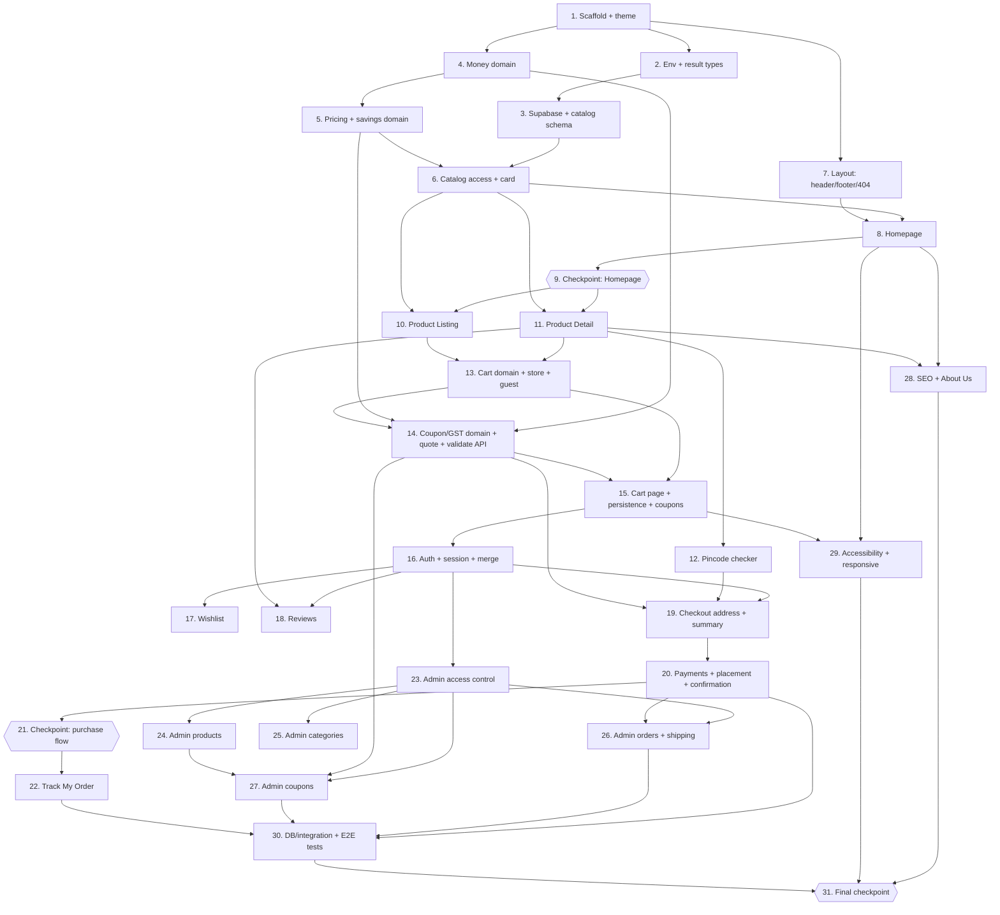

# Implementation Plan: Nutraciti E-commerce Storefront

## Overview

This plan converts the design into incremental, test-driven coding tasks for a Next.js 14 (App Router) + TypeScript storefront backed by Supabase and Razorpay. Work is ordered so the **Homepage is a reachable early milestone** (Task 8): scaffold and theme, env/config, Supabase clients and the base catalog schema, the pure money/pricing/savings domain modules with their property tests, then layout and the Homepage with seed data. After that the plan builds Product Listing, Product Detail, Pincode checker, Cart, Auth, Wishlist, Reviews, Checkout, Payments, Order tracking, the Admin dashboard, SEO, accessibility, and the database/integration and end-to-end test suites.

Conventions used below:
- Pure business rules live in `src/lib/domain/*`; UI in `src/components/*`; mutations in server actions/route handlers per the design's Project structure.
- All money is integer paise. The browser and server call the same domain functions.
- Sub-tasks postfixed with `*` are test sub-tasks and may be skipped for a faster MVP. Each Correctness Property has exactly one fast-check test, tagged `// Feature: nutraciti-ecommerce, Property N: <title>`.
- Tasks postfixed with **(Optional)** are polish and not required for a correct MVP.
- `_Requirements:_` lines cite the specific acceptance-criteria clauses each task satisfies.

## Tasks

- [ ] 1. Scaffold the project, tooling, and brand theme
  - [ ] 1.1 Initialize Next.js 14 (App Router) + TypeScript + Tailwind
    - Create the app with `create-next-app` (App Router, TS, ESLint), add Tailwind, and lay out the `src/` tree from the design's Project structure (`app/`, `components/`, `lib/`, `supabase/`, `tests/`)
    - Add `supabase/` and `tests/{unit,property,e2e}/` folders and a root `README` note on `supabase start`
    - _Requirements: 23.1_
  - [ ] 1.2 Configure brand theme tokens and fonts
    - Define `gold`, `bronze`, `background`, `surface`, `border` as the only hex occurrences in `tailwind.config.ts`; add `heading`/`body`/`label` font families
    - Load Playfair Display, DM Sans, Hanken Grotesk via `next/font/google` with `display: 'swap'` in `app/layout.tsx`; set base element fonts and page background in `globals.css` `@layer base`
    - _Requirements: 1.1, 1.2, 1.4, 1.5, 1.6, 1.7, 1.11, 1.10_
  - [ ] 1.3 Set up test tooling
    - Install and configure Vitest, fast-check, and Playwright; add `tests/property/arbitraries.ts` scaffold (`paise`, `invalidAmount`, `product`, `cart`, `cartOp`, `coupon`, `rupeeString`, `codeString`)
    - Add test scripts to `package.json`
    - _Requirements: 23.1_
  - [ ]* 1.4 Write the brand-hex scan unit test
    - Scan `src/components` and `src/app`; fail if any of the five brand hex values appears outside `tailwind.config.ts`
    - _Requirements: 1.1_

- [ ] 2. Add environment config and shared result types
  - [ ] 2.1 Implement `lib/env.ts` and `.env.example`
    - Parse all seven env vars with zod at build time, failing the build and naming any missing/empty variable; require `rzp_test_`/`rzp_live_` key prefixes per `VERCEL_ENV`; list every name with empty values in `.env.example`
    - Keep the service-role/secret values server-only (module imports `server-only`)
    - _Requirements: 23.2, 23.3, 23.4, 23.6, 23.7, 22.3_
  - [ ] 2.2 Implement `lib/result.ts` shared types
    - Define `Result<T,E>`, `AppError` (`status`, `code`, `message`, `fieldErrors?`), `Paise`, `PaymentMethod`, `FulfilmentStatus`, and `withTimeout(promise, ms)`
    - _Requirements: 22.7, 22.9_

- [ ] 3. Supabase clients, session helpers, and base catalog schema
  - [ ] 3.1 Create Supabase client modules
    - Add `lib/supabase/{browser,server,middleware,service,types}.ts`; `service.ts` imports `server-only`; `middleware.ts` exports `updateSession` that refreshes tokens via `getUser()`
    - Add `src/middleware.ts` that runs session refresh on all non-asset, non-webhook routes
    - _Requirements: 8.3, 22.3, 23.7_
  - [ ] 3.2 Write migration `0001_schema.sql` for the catalog
    - Create `profiles`, `categories`, `products`, `pincodes`, `store_settings` tables with bigint paise money columns, check constraints (Selling_Price ≤ MRP, stock ≥ 0, GST_Rate 0–40), slug uniqueness, and `active`/`archived`/`featured` flags
    - _Requirements: 25.24, 22.1_
  - [ ] 3.3 Write migration `0002_rls.sql` for catalog read policies
    - Enable RLS; allow any requester to read active, non-archived products/categories; restrict writes to admins; add the `is_admin()` SECURITY DEFINER helper
    - _Requirements: 22.10, 24.2_
  - [ ] 3.4 Add `supabase/seed.sql` with sample data
    - Seed several categories, featured and non-featured active products with images, and a set of serviceable pincodes so the Homepage and catalog render locally
    - _Requirements: 3.2, 3.3, 11.2_
  - [ ] 3.5 Add session/auth read helpers and `safeNextPath`
    - Implement `getSessionUser`, `requireCustomer(nextPath)`, `requireAdmin`, `assertAdmin` in `lib/auth.ts`; implement the pure `safeNextPath` (same-origin relative paths only, never `/login`)
    - _Requirements: 8.1, 8.4, 8.6, 7.3, 24.1, 24.5_
  - [ ] 3.6 Generate `lib/supabase/types.ts`
    - Run `supabase gen types typescript` against the local DB and commit the output
    - _Requirements: 23.1_

- [ ] 4. Implement the money domain module (`lib/domain/money.ts`)
  - [ ] 4.1 Implement `formatINR`, `parseINR`, `rupeesToPaise`, `paiseToRupees`
    - Indian digit grouping, `₹` prefix, two-paise decimals only when non-zero, locale-independent output; `rupeesToPaise` for form-boundary conversion; throw `InvalidAmountError` on invalid input
    - _Requirements: 13.1, 13.2, 13.3, 13.6, 13.7, 25.11, 25.25, 31.9_
  - [ ]* 4.2 Write property test for the INR formatter
    - **Property 6: INR formatter round-trip and determinism** — fast-check over all valid paise under different `TZ`/`LANG`
    - _Requirements: 13.5, 13.7_
  - [ ]* 4.3 Write property test for invalid amounts
    - **Property 7: Invalid amounts are rejected** — negatives, non-integers, non-finite, non-numbers, above max throw and return no string
    - _Requirements: 13.6_
  - [ ]* 4.4 Write property test for rupee/paise round-trip
    - **Property 13: Rupee and paise round-trip** — `rupeesToPaise(paiseToRupees(p)) === p`
    - _Requirements: 25.25_
  - [ ]* 4.5 Write example unit tests
    - Assert documented cases (`₹1,23,456`, `₹0.05`, `₹1,500`) and boundary groupings
    - _Requirements: 13.1, 13.2, 13.3_

- [ ] 5. Implement product pricing and savings domain
  - [ ] 5.1 Implement display helpers in `lib/domain/pricing.ts`
    - `discountPercent` (floor of ((MRP − SP) ÷ MRP) × 100), "You save" amount, and stock-status helpers used by cards and the detail page
    - _Requirements: 4.3, 5.1, 5.7_
  - [ ] 5.2 Implement `lib/domain/savings.ts`
    - `cartSavings` as Σ (MRP − Selling_Price) × quantity over current snapshots, excluding shipping/COD fees
    - _Requirements: 12.1_
  - [ ]* 5.3 Write property test for savings
    - **Property 5: Savings are non-negative and complete the MRP total** — `cartSavings ≥ 0` and `cartSavings + subtotal = Σ MRP × qty`
    - _Requirements: 12.5, 12.6_
  - [ ]* 5.4 Write example unit tests for discount percent
    - Assert the ₹999/₹799 → 20% case and equal-price (no discount) case
    - _Requirements: 4.3, 5.7_

- [ ] 6. Build catalog data access and the product card
  - [ ] 6.1 Implement cached catalog reads in `lib/services/catalog.ts`
    - Wrap anon-key reads in `unstable_cache` with tags `catalog`, `product:<slug>`, `categories`; provide featured-product, category-with-active-product, and product-by-slug reads
    - _Requirements: 3.2, 3.3, 4.1, 5.1_
  - [ ] 6.2 Implement the `Price`, `ProductCard`, and `ProductGrid` components
    - `Price` renders `formatINR` output; `ProductCard` shows image, name, Selling_Price, strikethrough MRP and discount %, and an "Add to Cart" button; styled with surface/border tokens
    - _Requirements: 4.2, 4.3, 13.4, 1.3_

- [ ] 7. Build the site layout: header, footer, navigation, 404
  - [ ] 7.1 Implement `Header`, `AccountMenu`, `CartIcon`, `WishlistIcon`, and `MobileMenu`
    - Logo→Home, nav links (Home, Shop, Track My Order, About Us), account link, wishlist and cart icons; hide nav under 768px behind a menu button that opens/closes correctly; account menu shows My Wishlist and, for admins, Admin Dashboard
    - Render badge placeholders (wired to stores in Tasks 12/16); account link target depends on session
    - _Requirements: 2.1, 2.3, 2.7, 2.8, 2.9_
  - [ ] 7.2 Implement `Footer`
    - About Us link, Track My Order link, email + phone contact details, and configured social links opening in a new tab
    - _Requirements: 2.4, 28.1_
  - [ ] 7.3 Implement the not-found page (`app/not-found.tsx`)
    - Standard header/footer, link to Homepage, HTTP 404, `noindex`
    - _Requirements: 2.5, 21.9_

- [ ] 8. Build the Homepage (early milestone)
  - [ ] 8.1 Implement `app/page.tsx` sections
    - Hero (headline, supporting line, "Shop Now"→ unfiltered listing), featured products (1–8 active featured via `ProductCard`), category links (one per category with ≥1 active product), and brand-promise section (ingredient quality, cruelty-free, Free_Shipping_Threshold via `Price`, COD available); ISR with `catalog`/`categories` tags
    - _Requirements: 3.1, 3.2, 3.3, 3.4, 3.8, 21.1_
  - [ ] 8.2 Handle empty and read-failure fallbacks
    - Hide featured/category sections (no heading, no placeholder) when empty; on a catalog read failure still render hero + brand promise with no error page
    - _Requirements: 3.5, 3.6, 3.7_

- [ ] 9. Checkpoint — Homepage reachable
  - Ensure the app builds, the Homepage renders with seed data, and all property/unit tests pass; ask the user if questions arise.

- [ ] 10. Build the Product Listing page (`app/shop/page.tsx`)
  - [ ] 10.1 Implement listing, filtering, sorting, and URL state
    - Render active products (including zero-stock) as cards; category filter with "All"; sort by Price asc/desc and Newest with name tiebreak; write category/sort/page to query params and reset page to 1 on filter/sort change; "Out of Stock" label disables the card's Add to Cart
    - _Requirements: 4.1, 4.2, 4.4, 4.5, 4.6, 4.7, 4.8_
  - [ ] 10.2 Implement pagination and parameter validation
    - Paginate at 12/page with prev/next controls and page count; ignore invalid category/sort/page params and rewrite the URL to applied values
    - _Requirements: 4.10, 4.11_
  - [ ] 10.3 Implement empty and error states
    - "No products found" with a clear-filter button for empty category results; load-failure message with a "Retry" that repeats the current query and never shows "No products found"
    - _Requirements: 4.9, 4.12_

- [ ] 11. Build the Product Detail page (`app/products/[slug]/page.tsx`)
  - [ ] 11.1 Implement detail content and gallery
    - Name, image gallery with thumbnail switching, Selling_Price/MRP, description, ingredients, usage, stock status, and "You save ₹X"; 404 for unknown/inactive slug
    - _Requirements: 5.1, 5.2, 5.7, 5.8_
  - [ ] 11.2 Implement the quantity selector and add/buy controls
    - Quantity selector clamped 1..Max_Item_Quantity with disabled bounds and value coercion; "Add to Cart" (stay, ≥3s confirmation) and "Buy Now" (→ checkout); disable all controls and show "Out of stock" at zero stock; max-reached and add-failure messages
    - _Requirements: 5.3, 5.4, 5.5, 5.10, 5.11, 5.12_
  - [ ] 11.3 Add Product Detail SEO metadata
    - Page title with product name, meta description from first ≤160 chars of description, Open Graph image = first gallery image
    - _Requirements: 5.9, 21.5_

- [ ] 12. Build the Pincode checker
  - [ ] 12.1 Implement `lib/services/pincode.ts` and `GET /api/pincode/[pincode]`
    - Server lookup returning `{ pincode, deliveryDays, codAvailable }` or null; 10s timeout; `Cache-Control: s-maxage=3600`
    - _Requirements: 11.2, 11.3, 11.4, 11.10_
  - [ ] 12.2 Implement the `PincodeChecker` component
    - 6-char digit-only input, IST estimated-delivery date ("18 Jan"), COD status message, invalid/not-serviceable messages, local-storage persistence and prefill (no auto-submit), loading state, and timeout retry; place it on the Product Detail page
    - _Requirements: 11.1, 11.2, 11.3, 11.4, 11.5, 11.6, 11.7, 11.8, 11.9, 11.10, 5.6_
  - [ ] 12.3 Implement `lib/domain/dates.ts` IST helpers
    - Pure IST date arithmetic (clock passed in) for delivery dates and coupon expiry comparisons
    - _Requirements: 11.2, 31.12_

- [ ] 13. Implement the cart domain, store, and guest persistence
  - [ ] 13.1 Implement `lib/domain/cart.ts`
    - `addLine`, `setQty`, `removeLine`, `clampToMax`, `subtotal`, `serializeCart`/`deserializeCart`, `mergeCarts`, `cartEquivalent`; enforce 1..Max_Item_Quantity and one line per product; corrupt input returns a `corrupt` result
    - _Requirements: 9.1, 9.2, 9.3, 9.4, 9.5, 9.9, 9.10, 9.12, 10.5, 10.7_
  - [ ]* 13.2 Write property test for cart limits and uniqueness
    - **Property 1: Cart lines stay within limits and unique**
    - _Requirements: 9.9_
  - [ ]* 13.3 Write property test for subtotal
    - **Property 2: Subtotal equals the sum of line totals**
    - _Requirements: 9.10_
  - [ ]* 13.4 Write property test for serializer round-trip
    - **Property 3: Cart serializer round-trip**
    - _Requirements: 10.7, 10.8_
  - [ ]* 13.5 Write property test for merge confluence
    - **Property 4: Cart merge is confluent**
    - _Requirements: 10.9_
  - [ ] 13.6 Implement the client cart store (`lib/stores/cart-store.ts`)
    - Zustand store calling the domain functions; `add`/`setQuantity`/`remove`, notices ("Only N units available", removed products), guest localStorage persistence within 1s via the serializer, and reload restore
    - _Requirements: 9.1, 9.2, 9.3, 9.4, 9.5, 9.11, 10.1, 10.3_
  - [ ] 13.7 Wire the header cart badge
    - Show total quantity (">99+" above 99) updated within 1s without reload; no badge when empty
    - _Requirements: 2.2, 2.6_

- [ ] 14. Implement coupon and GST domain, quote, and the validate API
  - [ ] 14.1 Implement `lib/domain/coupon.ts`
    - `normaliseCode` (trim + uppercase), `computeDiscount` (percent = floor(subtotal×value÷100), flat = value, capped at subtotal)
    - _Requirements: 33.1, 33.3, 33.4, 33.5, 33.12_
  - [ ]* 14.2 Write property tests for coupon discount and normalisation
    - **Property 29: Coupon discount is bounded and deterministic** and **Property 30: Code normalisation is idempotent**
    - _Requirements: 33.12, 33.14, 33.15_
  - [ ] 14.3 Implement `lib/domain/gst.ts`
    - `allocateDiscount` (floor shares + largest-remainder allocation by line total then product id) and `gstForLine` ((lineTotal − share) × rate ÷ (100+rate), half-up); Cart/Order GST = sum of line GST
    - _Requirements: 34.1, 34.2, 34.3, 34.4, 34.11, 34.12, 34.13, 34.15_
  - [ ]* 14.4 Write property tests for GST allocation and line GST
    - **Property 32: Discount allocation is exact and bounded** and **Property 33: GST amount bounds and zero rate**
    - _Requirements: 34.12, 34.13, 34.15_
  - [ ] 14.5 Implement `computeQuote` in `lib/domain/pricing.ts`
    - Subtotal, Coupon_Discount, Shipping_Fee (free at/above threshold on Discounted_Subtotal), COD_Fee (COD only), Order_Total identity, savings, and the full GST breakdown; reused by cart, checkout, confirmation, and admin views
    - _Requirements: 15.1, 15.2, 15.3, 15.6, 16.13, 17.1, 17.2, 17.3, 33.10, 34.4, 34.5, 34.6, 34.7_
  - [ ]* 14.6 Write property tests for the quote
    - **Property 8: Order total identity and non-negativity**, **Property 28: Applying then removing a coupon restores the quote**, and **Property 34: GST round-trip from stored Orders** (PBT over `computeQuote` output)
    - _Requirements: 15.6, 32.14, 34.14_
  - [ ] 14.7 Add coupons table, rate limiting, and the validate endpoint
    - Migration for `coupons` and `rate_limits` plus the `check_rate_limit` SECURITY DEFINER function; `lib/services/coupon.ts` (`validate` with ordered checks and rate limit) and `POST /api/coupons/validate` returning the correct statuses/messages
    - _Requirements: 32.3, 32.7, 32.12, 32.13, 33.1, 33.2_

- [ ] 15. Build the Cart page with persistence and coupons
  - [ ] 15.1 Add the carts schema and cart server actions
    - Migration for `carts`/`cart_items` with owner-only RLS and the `save_cart` SECURITY INVOKER function; implement `reconcileCart`, `loadCart`, `saveCart` (never overwrites with empty on read failure), with authenticated save within 2s
    - _Requirements: 10.2, 10.6, 10.10, 22.1_
  - [ ] 15.2 Implement the Cart page UI
    - Per-line image, name, Selling_Price, MRP, quantity selector, line total, remove; Subtotal, Shipping_Fee, savings, Coupon_Discount, total payable, all `Price`-formatted and updated within 1s; empty-cart state with Continue Shopping
    - _Requirements: 9.6, 9.7, 9.8, 12.2, 12.3, 12.7_
  - [ ] 15.3 Implement cart reconcile on load
    - On Cart page load, clamp over-max quantities with "Only N units available" and remove inactive/zero-stock lines, naming each affected product
    - _Requirements: 9.13, 10.6_
  - [ ] 15.4 Implement the `CouponBox` and savings line
    - Apply/remove coupon via the store and `/api/coupons/validate`, single-coupon rule, applied/removed messages and reason messages, re-validation within 1s on cart changes, and the MRP-savings line kept separate from the coupon discount
    - _Requirements: 32.1, 32.2, 32.4, 32.5, 32.6, 32.7, 32.9, 32.10, 32.11, 32.13_

- [ ] 16. Implement authentication, session guards, and cart merge
  - [ ] 16.1 Add the profile-creation trigger and profile RLS
    - `AFTER INSERT` trigger on `auth.users` creating exactly one `profiles` row (OTP and Google); owner-only profile policies that forbid changing `role`
    - _Requirements: 6.9, 7.5, 7.6, 7.7, 22.1_
  - [ ] 16.2 Implement OTP login (`app/login/page.tsx` + `lib/auth-client.ts`)
    - "+91" prefixed 10-digit input; `sendOtp`/`verifyOtp` with validation, 30s resend countdown, 6-digit entry, success redirect via `safeNextPath`, and the incorrect/expired, rate-limit, and timeout error paths
    - _Requirements: 6.1, 6.2, 6.3, 6.4, 6.5, 6.6, 6.7, 6.8, 6.10, 6.11_
  - [ ] 16.3 Implement Google login and the callback route
    - "Continue with Google" button + `signInWithGoogle`; `app/auth/callback/route.ts` exchanges the code, redirects via `safeNextPath`, and handles the cancel/error path leaving the guest cart unchanged
    - _Requirements: 7.1, 7.2, 7.3, 7.4_
  - [ ] 16.4 Add route guards to middleware and the account page
    - Guard `/checkout`, `/account/*`, `/wishlist`, `/orders/*`, `/admin/*` → redirect to `/login?next=…` (with `&wish=` for pending wishlist); redirect signed-in users away from `/login`; build `app/account/page.tsx` (masked-number/name display, addresses, order history, Sign Out)
    - _Requirements: 8.2, 8.4, 8.5, 8.7, 8.8, 2.10, 24.3_
  - [ ] 16.5 Implement guest-cart merge and sign-out handling
    - `mergeGuestCart` summing quantities capped at Max_Item_Quantity, keeping the guest coupon when present, clearing localStorage on success, retrying on next load on failure; on sign-out keep the Supabase cart and start an empty guest cart
    - _Requirements: 10.4, 10.11, 10.12, 32.8_
  - [ ]* 16.6 Write a unit test for `safeNextPath`
    - Cover open-redirect, cross-origin, and `/login` self-redirect cases
    - _Requirements: 7.3, 8.6_

- [ ] 17. Implement the Wishlist
  - [ ] 17.1 Add the wishlist schema and `toggle`/list actions
    - Migration for `wishlists` with a unique (user, product) constraint and owner-only RLS; `src/actions/wishlist.ts` `toggle` (insert on-conflict-do-nothing, reject at 100 active, 404 for inactive), `applyPendingAddition`, and `listWishlist`
    - _Requirements: 30.3, 30.4, 30.8, 30.13, 30.18, 30.19_
  - [ ] 17.2 Implement the wishlist store and heart button
    - `wishlist-store` reducer with optimistic toggle and rollback on failure/timeout; `WishlistHeart` with correct pressed state/labels and keyboard operation on cards and the detail page; guest click redirects to login with the pending addition
    - _Requirements: 30.1, 30.2, 30.5, 30.6, 30.7_
  - [ ] 17.3 Build the Wishlist page and header badge
    - Active-product cards ordered newest-first with Add to Cart (qty 1, max-reached handling) and Remove, out-of-stock handling, empty state, hidden inactive/archived products, and the header badge of active count
    - _Requirements: 30.9, 30.10, 30.11, 30.12, 30.14, 30.15, 30.16_
  - [ ]* 17.4 Write property test for the wishlist toggle
    - **Property 25: Wishlist toggle round-trip** — PBT on the `wishlist-store` reducer
    - _Requirements: 30.17_

- [ ] 18. Implement Product Reviews
  - [ ] 18.1 Implement `lib/domain/rating.ts`
    - `averageRating(sum, count)` rounded to one decimal, halves up, bounded 1.0–5.0
    - _Requirements: 29.25_
  - [ ]* 18.2 Write property test for average rating
    - **Property 23: Average rating formula and bounds**
    - _Requirements: 29.25_
  - [ ] 18.3 Add the reviews schema and review actions
    - Migration for `reviews` with a unique (user, product) constraint and RLS (any customer reads active-product reviews); `src/actions/reviews.ts` `upsert` (Verified_Buyer check, on-conflict update keeping `created_at`, 404 for inactive/archived, revalidateTag), `remove` (owner/admin only), `listReviews`, `getReviewEligibility`
    - _Requirements: 29.12, 29.13, 29.16, 29.18, 29.22, 29.23, 29.26, 29.27_
  - [ ] 18.4 Build the reviews UI on the Product Detail page
    - Average + count next to the name, newest-first list with Load more (10 at a time), star rating input (keyboard, accessible labels), 10–1000 char text, write/edit/delete states, plain-text rendering of names/text, product-card rating, and the save-failure/timeout path
    - _Requirements: 29.1, 29.2, 29.3, 29.4, 29.5, 29.6, 29.7, 29.8, 29.9, 29.10, 29.11, 29.14, 29.15, 29.17, 29.21, 29.24_

- [ ] 19. Build Checkout address and order summary
  - [ ] 19.1 Add the addresses schema and address actions
    - Migration for `addresses` with owner-only RLS; `saveAddress`/`confirmSavedAddress` with full field validation, the 28+8 state list, serviceability gating to the payment step, and save/lookup failure paths
    - _Requirements: 14.1, 14.2, 14.3, 14.4, 14.5, 14.6, 14.7, 14.8, 14.9_
  - [ ] 19.2 Implement `quoteCheckout` and the order summary UI
    - `checkout/actions.ts` `quoteCheckout` using `computeQuote`; order summary listing items, Subtotal, Coupon_Discount (code shown), Shipping_Fee ("FREE"/shortfall message), COD_Fee (COD only), savings, Order_Total, and the GST breakdown (single-rate and multi-rate lines, hidden at zero); live updates within 1s; redirect to Cart when empty
    - _Requirements: 15.1, 15.2, 15.3, 15.7, 15.9, 34.5, 34.6, 34.7_

- [ ] 20. Implement order placement, payments, and confirmation
  - [ ] 20.1 Add the orders schema and atomic order functions
    - Migration for `orders`/`order_items` with the immutability guard, `NC-YYMMDD-NNNNN` Order_Number, and the SECURITY DEFINER functions `place_order`, `mark_order_paid`, `mark_order_failed`, `convert_order_to_cod` (EXECUTE granted to `service_role` only); store per-line GST_Rate, Line_Discount_Share, GST_Amount and the server-computed totals
    - _Requirements: 15.4, 18.1, 22.4, 33.8, 34.8_
  - [ ] 20.2 Implement server-side placement and re-checks
    - `placeOrder` recomputing all amounts server-side, re-validating the coupon (Req 33.6/33.7), and rejecting on price/stock/availability change with per-product messages and cart adjustment; COD creates a Placed_Order + stock decrement + times_used + cart clear in one transaction; Online creates a pending Order with no Fulfilment_Status
    - _Requirements: 15.4, 15.5, 15.8, 16.2, 16.13, 17.4, 17.5, 17.6, 18.4, 18.5, 33.6, 33.7, 33.9, 33.11_
  - [ ] 20.3 Implement the COD payment option UI
    - Enable/disable COD per pincode COD flag and COD_Limit (incl. COD_Fee), reason messages, COD_Fee line and Order_Total update within 1s, place-order button disabled while submitting, and clearing COD when pincode/cart changes
    - _Requirements: 16.1, 17.1, 17.2, 17.3, 17.7, 17.8_
  - [ ] 20.4 Implement Razorpay order creation and launch
    - `createRazorpayOrder` (10s timeout → "failed"; reuse for retry, no second Order), `lib/razorpay/client.ts` (server-only) and `load-checkout.ts` (browser), and the `RazorpayLauncher` opening Checkout with prefill and enabled methods; disable Pay Online below ₹1
    - _Requirements: 16.2, 16.3, 16.6, 16.7, 16.10, 16.13, 33.11_
  - [ ] 20.5 Implement payment verification, webhook, and polling
    - `lib/razorpay/signature.ts` (constant-time), `verifyPayment` → `mark_order_paid`/`mark_order_failed`, `app/api/razorpay/webhook/route.ts` (raw body, signature check, 400/404 on bad/unknown, no-op when already paid), `reportPaymentDismissed`, `getPaymentStatus` polling with the 15s "payment is being confirmed" path, and `convertToCod`
    - On a `stock_conflict` from `mark_order_paid`: store only `razorpay_payment_id`, place no order, make no stock change, log `stock_conflict` and flag for manual refund, and show the customer exactly: "We're sorry — this item just went out of stock. Your payment will be refunded within 5-7 business days." (per user confirmation 1)
    - _Requirements: 16.4, 16.5, 16.6, 16.7, 16.8, 16.9, 16.11, 16.12, 22.8_
  - [ ] 20.6 Build the order confirmation page (`app/orders/[orderNumber]/page.tsx`)
    - Owner-only (404 otherwise), showing Order_Number, items, address, payment method, totals, GST breakdown and savings from stored values, estimated delivery date, a "Track this order" link, and the "Payment was not completed" state for pending/failed Online Orders
    - _Requirements: 16.5, 18.2, 18.3, 18.6, 18.7, 12.4, 12.8, 28.14_

- [ ] 21. Checkpoint — purchase flow works end to end
  - Ensure migrations apply, a COD and an Online order can be placed against local Supabase, and all property/unit tests pass; ask the user if questions arise.

- [ ] 22. Build Track My Order
  - [ ] 22.1 Implement `lib/domain/tracking.ts`
    - `matches` (normalised Order_Number + delivery mobile) and `progressSteps` (dates up to the current status, none after)
    - _Requirements: 28.16, 28.18_
  - [ ]* 22.2 Write property tests for tracking
    - **Property 20: Tracking match agrees with the reference model** and **Property 22: Progress steps show dates up to the current status**
    - _Requirements: 28.16, 28.18_
  - [ ] 22.3 Implement the tracker service and `POST /api/track`
    - `lib/services/tracker.ts` `lookup`/`lookupForOwner` returning only allowed fields, IP rate limiting, and a single frozen response for every non-match
    - _Requirements: 28.5, 28.9, 28.10, 28.11, 28.15, 28.17_
  - [ ]* 22.4 Write property test for indistinguishable non-matches
    - **Property 21: Non-matching lookups are indistinguishable** — against the route handler with a mocked service client
    - _Requirements: 28.17_
  - [ ] 22.5 Build the `app/track/page.tsx` UI
    - Order_Number + "+91" mobile inputs with validation, progress indicator (with the "cancelled" variant), courier/tracking display when shipped/delivered, `?order=` prefill, owner path without mobile, loading state, and the timeout retry
    - _Requirements: 28.1, 28.2, 28.3, 28.4, 28.6, 28.7, 28.8, 28.12, 28.13_

- [ ] 23. Build Admin access control and layout
  - [ ] 23.1 Implement the admin layout and nav
    - `app/admin/layout.tsx` calling `requireAdmin()` (→ `notFound()` for non-admins), `noindex`, redirect `/admin`→`/admin/products`, and `AdminNav` (Products, Categories, Orders, Coupons) with active marking; every admin action starts with `assertAdmin()` and rejects any `role` field with 403
    - _Requirements: 24.1, 24.3, 24.4, 24.5, 24.6, 24.7, 24.8, 24.9, 24.10_

- [ ] 24. Build Admin product management
  - [ ] 24.1 Implement `lib/domain/slug.ts`
    - `slugify` (lowercase, non-alphanumeric runs → single hyphen, trim hyphens) and `isValidSlug`
    - _Requirements: 25.6, 25.7, 25.26, 26.4_
  - [ ]* 24.2 Write property test for slugs
    - **Property 14: Slug format and idempotence**
    - _Requirements: 25.26_
  - [ ] 24.3 Implement `productSchema` validation
    - Zod schema in `lib/validation` enforcing name 2–120, slug rules, text length exceptions, category required, MRP/Selling_Price whole paise >0 with SP≤MRP, GST_Rate 0–40 (default 18), stock 0–99999, and 1–8 images
    - _Requirements: 25.4, 25.5, 25.7, 25.9, 25.10, 25.11, 25.12, 25.13, 25.14, 25.24_
  - [ ]* 24.4 Write property test for the product invariant
    - **Property 12: Product invariant** — PBT over `productSchema`
    - _Requirements: 25.24_
  - [ ] 24.5 Implement signed-URL image upload and storage
    - Migration `0004_storage.sql` for the `product-images` bucket; `createImageUploadUrls` issuing signed URLs to a `staging/` path; browser uploads directly to Supabase Storage; `saveProduct` validates each staged file's magic bytes and size server-side, moves to `products/<id>/`, and deletes staged files on failure (per user confirmation 2)
    - _Requirements: 25.15, 25.16, 25.18_
  - [ ] 24.6 Build the product list and add/edit forms
    - Products list (exclude archived, 20/page, search + category + status filters, "No products found" reset); add/edit `ProductForm` with live slug generation, slug-uniqueness rejection, image reorder, field-level errors keeping values, "Product saved", and revalidateTag within 60s
    - _Requirements: 25.1, 25.2, 25.3, 25.6, 25.8, 25.17, 25.19, 25.23_
  - [ ] 24.7 Implement product delete/archive
    - Confirm dialog; permanent delete + image removal when in no order; archive (inactive + archived, keep record/images/slug) when referenced by an order, with the respective messages
    - _Requirements: 25.20, 25.21, 25.22_
  - [ ]* 24.8 Write property test for rupee/paise round-trip at the form boundary
    - **Property 13 (form boundary): Rupee and paise round-trip** for `rupeesToPaise`/`paiseToRupees` over ₹0.01–₹1,00,000.00
    - _Requirements: 25.25_

- [ ] 25. Build Admin category management
  - [ ] 25.1 Implement `categorySchema` and category actions
    - Name 2–50, case-insensitive uniqueness, slug via `slugify` with generated-slug uniqueness, rename preserving product assignments and revalidating within 60s, and server-time delete guard (reject when products exist, delete when empty)
    - _Requirements: 26.2, 26.3, 26.4, 26.5, 26.6, 26.7, 26.9, 26.10, 26.11_
  - [ ] 25.2 Build the categories list and forms
    - List with name, slug, product count (incl. archived), ascending by name; add/edit forms and confirm dialog with the required messages
    - _Requirements: 26.1, 26.8_

- [ ] 26. Build Admin order management and shipping
  - [ ] 26.1 Implement `lib/domain/fulfilment.ts`
    - `decideTransition` (allowed one-step transitions, `noop` for same status, invalid otherwise) and `isValidHistory`/`progressSteps` history validation
    - _Requirements: 27.6, 27.8, 27.16, 27.19, 27.20_
  - [ ]* 26.2 Write property tests for fulfilment transitions
    - **Property 17: Fulfilment history is a valid prefix** and **Property 18: Status updates are idempotent** (PBT level)
    - _Requirements: 27.19, 27.20_
  - [ ] 26.3 Add the status-change and cancel functions
    - SECURITY DEFINER `transition_order_status` and `cancel_order` (restore stock exactly once in one transaction, set COD→paid on Delivered, optimistic version check), EXECUTE to `service_role` only
    - _Requirements: 27.10, 27.11, 27.12, 27.14, 27.15, 27.21_
  - [ ] 26.4 Build the orders list and detail UI
    - List (20/page, newest first, fulfilment + payment filters, order-number/mobile search with the two messages); detail page with stored line/GST/address/history data, only-allowed status controls, Shipped tracking/courier validation, cancel dialog with the refund note for paid Online Orders, stale-version and invalid-transition (409) handling, and disabled controls while submitting
    - _Requirements: 27.1, 27.2, 27.3, 27.4, 27.5, 27.7, 27.8, 27.9, 27.13, 27.17, 27.18, 34.9_

- [ ] 27. Build Admin coupon management
  - [ ] 27.1 Implement `couponSchema` and coupon actions
    - Code 3–20 alphanumeric stored uppercase, case-insensitive uniqueness, percent 1–90, flat ₹1–₹1,00,000, min-order ₹0–₹1,00,000, expiry not in the past; activate/deactivate; delete vs deactivate based on order references; leave stored order coupon data unchanged
    - _Requirements: 31.4, 31.5, 31.6, 31.7, 31.8, 31.9, 31.10, 31.11, 31.13, 31.14, 31.15, 31.17, 31.18, 31.19_
  - [ ]* 27.2 Write property test for coupon invariants
    - **Property 27: Coupon invariants** — PBT over `couponSchema`
    - _Requirements: 31.20_
  - [ ] 27.3 Build the coupons list and forms
    - List with type/value/min/expiry/active/times-used, expiry-ascending then code, "Expired" label, add/edit forms, and the delete confirm dialog with the required messages
    - _Requirements: 31.1, 31.2, 31.3, 31.16_

- [ ] 28. Implement SEO: sitemap, robots, and metadata
  - [ ] 28.1 Implement `app/sitemap.ts` and `app/robots.ts`
    - Sitemap (Homepage, listing, About Us, Track, every active product; exclude inactive/archived/personal/admin) with `catalog` tag + 3600s revalidate; robots.txt with the absolute sitemap URL disallowing admin/account/wishlist/orders/checkout
    - _Requirements: 21.6, 21.7, 21.8, 24.8_
  - [ ] 28.2 Add per-page metadata and noindex
    - Unique title (1–60) and description (50–160) per indexable page; `noindex` on wishlist, account, orders, and admin layouts
    - _Requirements: 21.4, 21.10_
  - [ ] 28.3 Build the About Us page
    - Brand story, mission/values, ingredient philosophy sections; contact details (email `mailto`, phone `tel` with +91), matching footer details, and a "Shop Now" button to the unfiltered listing
    - _Requirements: 19.1, 19.2, 19.3, 19.4, 19.5, 19.6_

- [ ] 29. Accessibility and responsive pass
  - [ ] 29.1 Apply responsive layout and touch targets
    - No horizontal scroll or overlap from 320–1920px; ≥44×44px targets for controls (except inline text links); Next.js image optimisation with correct intrinsic widths
    - _Requirements: 20.1, 20.2, 21.2_
  - [ ] 29.2 Apply keyboard, focus, labels, and contrast
    - Logical tab order, Enter/Space activation, modal focus trap + Escape/return focus, visible labels (no placeholder-only), ≥2px focus indicator at ≥3:1, image alt-text rules, accessible form errors moving focus to the first invalid field, and WCAG AA contrast (bronze for coloured text, dark text on gold)
    - _Requirements: 20.3, 20.4, 20.5, 20.6, 20.7, 20.8, 1.8, 1.9, 1.10_
  - [ ] 29.3 Add skeleton loaders and transitions (Optional)
    - Loading skeletons for catalog and reviews and subtle section transitions for a more premium feel
    - _Requirements: 21.3_

- [ ] 30. Build the database/integration and E2E test suites
  - [ ]* 30.1 Write DB integration tests for order placement and payment
    - **Property 8 (stored)**, **Property 9: Payment confirmation reduces stock exactly once**, **Property 10: Concurrent placement never drives stock negative**, and **Property 31: Checkout display equals stored Order values** against local Supabase with the real functions
    - _Requirements: 15.6, 16.9, 18.4, 34.10_
  - [ ]* 30.2 Write DB integration tests for admin authorization and catalog invariants
    - **Property 11: Only Admins write through admin endpoints**, **Property 15: Category names and slugs stay unique**, **Property 16: Category rename preserves products**, and **Property 12 (DB)** check constraints
    - _Requirements: 24.11, 25.24, 26.12, 26.13_
  - [ ]* 30.3 Write DB integration tests for fulfilment, reviews, wishlist, and GST
    - **Property 17/18 (DB)**, **Property 19: Cancellation restores stock exactly once**, **Property 24: One review per customer per product**, **Property 26: Wishlist entries are unique and adds are idempotent**, and **Property 34 (DB)**
    - _Requirements: 27.19, 27.20, 27.21, 29.26, 29.27, 30.18, 30.19, 34.14_
  - [ ]* 30.4 Write E2E tests for the core journeys
    - Playwright flows: browse → add to cart → apply coupon → checkout (COD and Online with a mocked gateway) → confirmation → track; login (OTP mock + Google callback) with guest-cart merge; and an admin product/order flow
    - _Requirements: 9.1, 15.1, 16.5, 17.6, 28.6, 10.4, 25.19, 27.10_

- [ ] 31. Final checkpoint — full build and test run
  - Ensure `next build` succeeds, all unit/property/integration/E2E tests pass, and no brand-hex or server-only leaks remain; ask the user if questions arise.

## Notes

- Sub-tasks marked `*` are tests and can be skipped for a faster MVP; tasks marked **(Optional)** are polish.
- Each Correctness Property is implemented by exactly one fast-check test placed next to the code it checks (PBT) or in Task 30 (DB-level), tagged with its property number and the requirement clause it validates.
- Migrations are introduced with the feature that first needs them (`0001` catalog, then carts, coupons/rate-limits, orders/functions, wishlists, reviews, addresses, storage, cron) so no schema is orphaned.
- The two user confirmations are reflected in Task 20.5 (stock-conflict-after-payment message and manual-refund logging) and Task 24.5 (browser-to-Storage signed-URL upload with server-side file validation).
- Checkpoints (Tasks 9, 21, 31) provide incremental validation; the Homepage milestone is reached at Task 9.

## Task Dependency Graph



```json
{
  "waves": [
    { "id": 0, "tasks": ["1"] },
    { "id": 1, "tasks": ["2", "4", "7"] },
    { "id": 2, "tasks": ["3", "5"] },
    { "id": 3, "tasks": ["6"] },
    { "id": 4, "tasks": ["8"] },
    { "id": 5, "tasks": ["9"] },
    { "id": 6, "tasks": ["10", "11"] },
    { "id": 7, "tasks": ["12", "13", "28"] },
    { "id": 8, "tasks": ["14"] },
    { "id": 9, "tasks": ["15"] },
    { "id": 10, "tasks": ["16", "29"] },
    { "id": 11, "tasks": ["17", "18", "19", "23"] },
    { "id": 12, "tasks": ["20", "24", "25"] },
    { "id": 13, "tasks": ["21", "26", "27"] },
    { "id": 14, "tasks": ["22"] },
    { "id": 15, "tasks": ["30"] },
    { "id": 16, "tasks": ["31"] }
  ]
}
```
